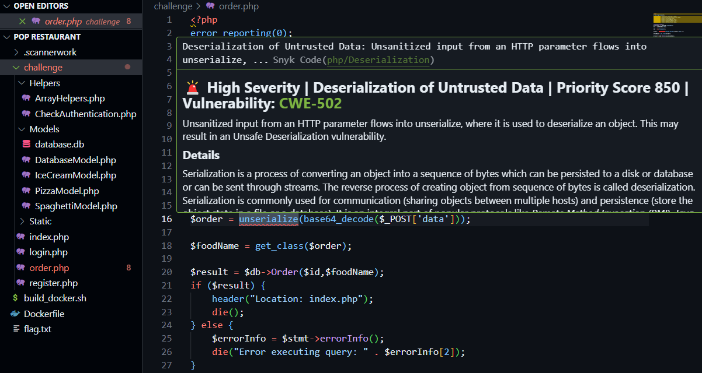

## The order request

Placing an order sends a `POST` request to `/order.php`. The order is carried in the `data` parameter:

```http
POST /order.php HTTP/1.1
Host: localhost:1337
Content-Length: 89
Cache-Control: max-age=0
sec-ch-ua: "Not)A;Brand";v="8", "Chromium";v="138"
sec-ch-ua-mobile: ?0
sec-ch-ua-platform: "Windows"
Accept-Language: en-US,en;q=0.9
Origin: http://localhost:1337
Content-Type: application/x-www-form-urlencoded
Upgrade-Insecure-Requests: 1
User-Agent: Mozilla/5.0 (Windows NT 10.0; Win64; x64) AppleWebKit/537.36 (KHTML, like Gecko) Chrome/138.0.0.0 Safari/537.36
Accept: text/html,application/xhtml+xml,application/xml;q=0.9,image/avif,image/webp,image/apng,*/*;q=0.8,application/signed-exchange;v=b3;q=0.7
Sec-Fetch-Site: same-origin
Sec-Fetch-Mode: navigate
Sec-Fetch-User: ?1
Sec-Fetch-Dest: document
Referer: http://localhost:1337/index.php
Accept-Encoding: gzip, deflate, br
Cookie: PHPSESSID=ddb569c9938b4b0eb08a7a04e5257c6a
Connection: keep-alive

data=Tzo1OiJQaXp6YSI6Mzp7czo1OiJwcmljZSI7TjtzOjY6ImNoZWVzZSI7TjtzOjQ6InNpemUiO047fQ%3D%3D
```

## The serialized object

Base64-decoding the `data` value gives a serialized PHP object:

```php
O:5:"Pizza":3:{s:5:"price";N;s:6:"cheese";N;s:4:"size";N;}
```

- **`O:5:"Pizza":3:`** means an Object with class name "Pizza" (5 characters long) with 3 properties
- **`s:5:"price"`** means a string property named "price" (5 characters long)
- **`N;`** represents NULL values
- The curly braces **`{}`** contain the object's properties

## The `Pizza` class

The matching class in the source defines a `__destruct()` method that echoes a property of one of its own properties:

```php
<?php
	class Pizza
	{
		public $price;
		public $cheese;
		public $size;

		public function __destruct()
		{
			echo $this->size->what;
		}
	}
```

## Source review

Reviewing the challenge source in VS Code, the server passes the attacker-controlled `data` parameter straight into `unserialize()`, which the Snyk extension flags as unsafe deserialization of untrusted data (CWE-502):


