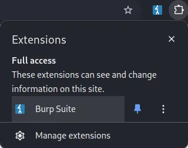
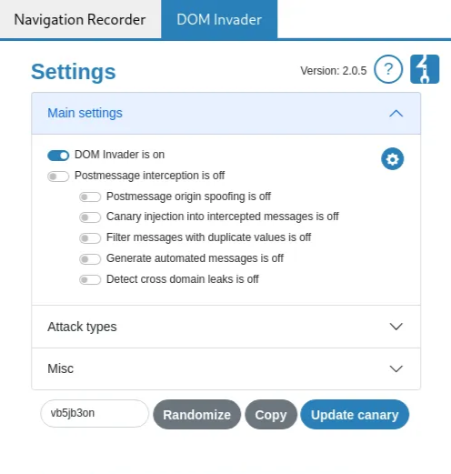
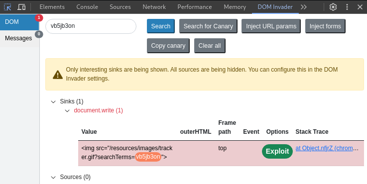
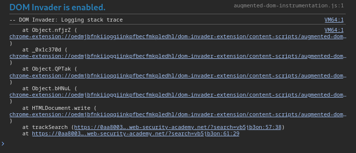
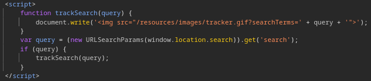
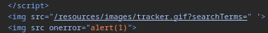

# DOM XSS in document.write sink using source location.search

```
❓

This lab contains a DOM-based cross-site scripting vulnerability in the search query tracking functionality. It uses the JavaScript `document.write` function, which writes data out to the page. The `document.write` function is called with data from `location.search`, which you can control using the website URL.

To solve this lab, perform a cross-site scripting attack that calls the `alert` function.
```

In this lab I’m going to try out using Burp Suites’ [`DOM Invader`](https://portswigger.net/burp/documentation/desktop/tools/dom-invader) 





Open the Burp Suite extension and make sure the “DOM Invader is on” slider is toggled, then click the “Copy” button to copy the canary to your clipboard and paste it in the search bar. Next up open `Inspect Element` and head over to the `DOM Invader` tab (it may be hidden for you so you’ll have to click the `>>` to see the rest of the tabs).



From here you can view the `Stack Trace` to see where the canary was triggered.





And of course, we have the big green Exploit button, clicking this will inject a test payload which may or may not work in some cases. 

```javascript
https://0aa800300368e44c802985e800be00c1.web-security-academy.net/?search=%22%27%3E%3Cimg%20src%20onerror=alert(1)%3E
```



After the payload is executed, an alert will be triggered and the lab will be completed.
