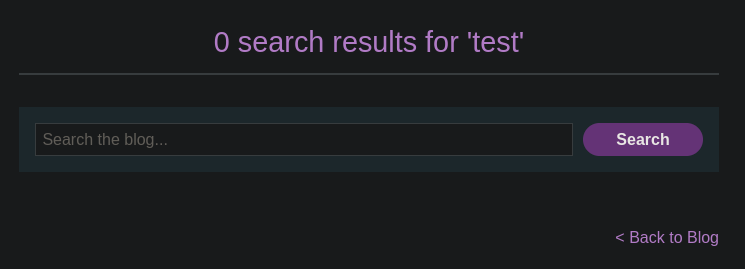
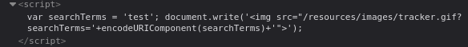

# Reflected XSS into a JavaScript string with angle brackets HTML encoded

```
❓

<p>
This lab contains a reflected cross-site scripting vulnerability in the search query tracking functionality where angle brackets are encoded. The reflection occurs inside a JavaScript string. To solve this lab, perform a cross-site scripting attack that breaks out of the JavaScript string and calls the `alert` function. 
</p>
```

In this lab we are tasked with triggering the alert function by escaping a string being called in JavaScript. For this lab we have search bar, after entering some test text I decide to check out the page source to see where my test text was reflected in the HTML. I stumble across a script tag where my test search was mentioned.





We can exploit this script by performing a string escape like so:

```javascript
'test';alert()\\;
```

The payload provided (`'test';alert()\\;`) is attempting to manipulate the JavaScript code snippet shown in the image. Let's analyze this step by step.

---

### **What the Code Does:**

1. **Code Context**:
   - The script defines a variable `searchTerms` with the value `'test'`.
   - It then uses `document.write()` to dynamically inject an `` tag into the HTML.
   - The `src` of the `` tag includes a tracking URL (`/resources/images/tracker.gif`) with a query parameter `searchTerms`, which is set to the encoded value of the `searchTerms` variable.

   
   Example result in HTML:
   

   ```html
   

   ```
2. **Purpose**:
   - This script is likely used for tracking user actions or input (e.g., logging search terms).
   - It appends the `searchTerms` value to the image URL, causing the browser to send a request with the encoded search term.

---

### **What Happens When the Payload is Inserted?**

The payload is:

```javascript
'test';alert()\\;

```

When this payload is injected into `searchTerms`, it effectively breaks out of the current JavaScript string and introduces arbitrary code.

### Modified Code After Injection:

```javascript
var searchTerms = 'test';alert()\\; document.write('');

```

### Key Points:

1. **Breaking the String**:
   - The `;` ends the string `'test'` and starts a new statement.
2. **Injected Code Execution**:
   - The `alert()` function is executed immediately, triggering a JavaScript alert dialog box.
3. **Escape Sequence (****`\\`****)**:
   - The `\\` might have been added to confuse parsers, but in this case, it comments out the rest of the code. It would likely just be ignored or cause a syntax error in some contexts.

---

### **What Happens Next?**

After executing `alert()`, the remaining part of the original code is still processed:

- The `document.write()` function continues execution.
- Depending on the JavaScript engine, this could either:
  - Write a broken `` tag due to the injected payload.
  - Cause an error and stop further execution.

---
