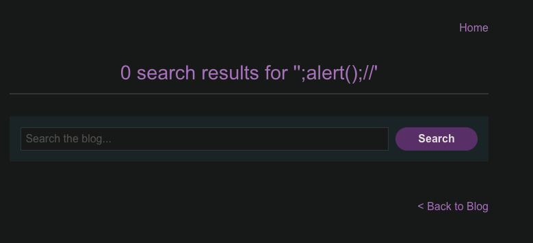

# Reflected XSS into a JavaScript string with angle brackets and double quotes HTML-encoded and single quotes escaped

```
❓

This lab contains a reflected cross-site scripting vulnerability in the search query tracking functionality where angle brackets and double are HTML encoded and single quotes are escaped.

To solve this lab, perform a cross-site scripting attack that breaks out of the JavaScript string and calls the `alert` function.
```

In this lab, the blog search feature is scripted to sanitize single and double quotes to prevent XSS, the script appends an escape character whenever a single quote is passed in the search query. 



The input is reflected **inside a JavaScript single-quoted string** that the page assembles like this:

```sql
<script>
    var searchTerms = '\';alert();//';
    document.write('');
</script>
```

Anything you supply is literally inserted between the two ' characters.

The goal is to **escape that string, terminate the assignment, run code, then neutralise the rest of the line** so the browser doesn’t throw a syntax error.

---

### **Payload, step by step**

```javascript
\';alert();//          ← what you type
```

| **Segment** | **JS interpreter sees** | **Purpose** |
|---|---|---|
| \\ | Backslash escape character | Escapes the **next** character so it is treated as data, not syntax. |
| ' | Literal single-quote inside the string | Because it’s escaped, it does **not** close the string. It means the first part of the string is now just a single backslash ('\\\\'). |
| ; | Outside the escape sequence | Ends the **string literal and the assignment**: the page now has var searchTerms = '\\\\'; (a perfectly valid statement). |
| alert(); | New JavaScript statement | Executes whatever you like—in the lab it’s alert(). |
| // | JavaScript line comment | Turns the remainder of the original line (including the closing ' added by the application) into a comment, preventing a syntax error. |

**Resulting source on the page**

```javascript
var searchTerms = '\\';      // ← harmless assignment
alert();                     // ← your injected code runs
//';                         // ← commented-out garbage that avoids a crash
```

---

### **Why the filter fails**

Many naïve sanitizers only escape **single quotes** by inserting a backslash (' → \\').

If they forget to escape **existing backslashes first**, an attacker can start with their own backslash, escape the next quote, and then inject code. PortSwigger calls this the *“single quote and backslash”* context.

---

### **Where to learn more**

| **Topic** | **Resource** |
|---|---|
| *Breaking out of JavaScript strings* | PortSwigger Web Security Academy lab **“Reflected XSS into a JavaScript string with single quote and backslash escaped”** |
| *General XSS filter-evasion techniques* | OWASP **XSS Filter Evasion Cheat Sheet** |
| *Anatomy of similar payloads* | Stack Overflow thread explaining ';alert(String.fromCharCode(...))// payload construction |
| *XSS fundamentals & prevention* | MDN Cross-Site Scripting overview and OWASP XSS Prevention Cheat Sheet |

Work through the PortSwigger lab first—it’s identical to the scenario you just exploited and will cement how these escape sequences behave.

### Final payload

```sql
<script>
    var searchTerms = '\\'; alert();//';
    document.write('');
</script>
```
