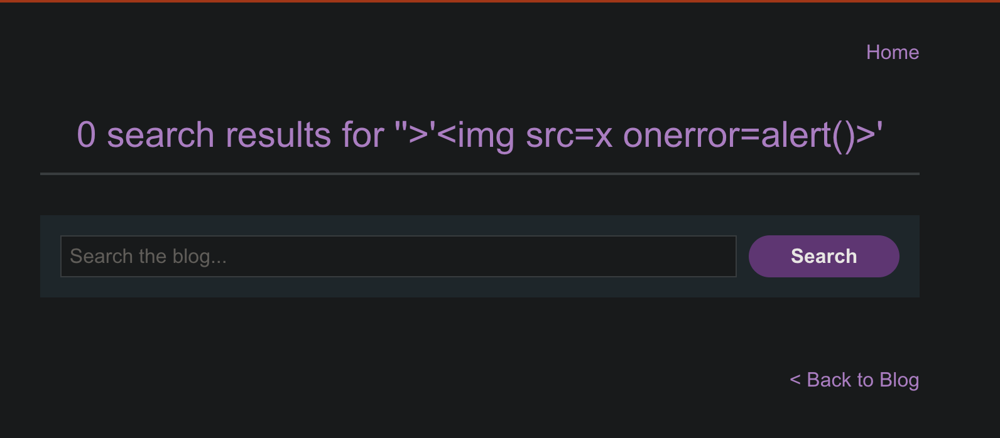

# Reflected XSS into a JavaScript string with single quote and backslash escaped

```
❓

This lab contains a reflected cross-site scripting  vulnerability in the search query tracking functionality. The reflection  occurs inside a JavaScript string with single quotes and backslashes  escaped.

To solve this lab, perform a cross-site scripting attack that breaks out of the JavaScript string and calls the `alert` function.
```

While testing the search bar, I inspected the HTML and found that the search was being encased in a script tag that was doing some form of sanitation.



```html
<script>
    var searchTerms = '';
    document.write('');
</script>
```

## **How \</script> is Used in this XSS**

If user input is embedded directly inside a \<script> block, an attacker can **break out** of the script with \</script> and then inject HTML or JavaScript after it.

---

### **Vulnerable Code**

```html
<script>
  var searchTerms = "[USER_INPUT]";
</script>
```

### **Attacker Input**

```html
</script>
```

### **Final Rendered Output**

```html
<script>
  var searchTerms = "</script>";
</script>
```

➡️ The browser sees:

1. \</script> — Closes the script tag early.
2. \ — Injected as raw HTML.
3. "> — This part is ignored, dangling leftover from the JS assignment.

✅ Result: The \ element executes alert(1) — **XSS triggered**.

---

## **Breakdown in Your Context**

### **Your Original Script**

```html
<script>
    var searchTerms = '';
    document.write('');
</script>
```

If the searchTerms variable instead came from **unescaped user input**, and the attacker inputs:

```html
</script>
```

The rendered script becomes:

```html
<script>
    var searchTerms = '</script>';
    document.write(...);
</script>
```

➡️ **BOOM** — JavaScript ends prematurely, and malicious HTML executes.

---

## **⚠️ Why This Works**

- Browsers don’t care that the \</script> is inside a string — they’ll end the script tag anyway.
- This is why user input should **never** be placed unescaped inside \<script> tags.

---
