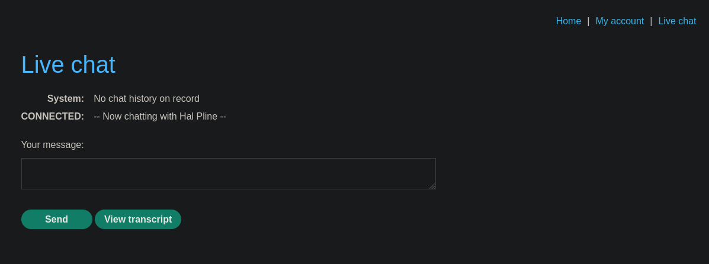
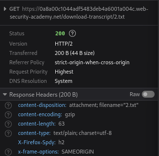

# Insecure direct object references

```
❓

This lab stores user chat logs directly on the server's file system, and retrieves them using static URLs.

Solve the lab by finding the password for the user `carlos`, and logging into their account.
```

We start off this lab with no login but there is a Live chat option. There is a `View transcript` button that downloads the chat log from the current session.





Although this functionality can be exploited by altering the number of the file that is downloaded for example `web-security-academy.net/download-transcript/1.txt` . Downloading file `1.txt` will give you the following text.

```txt
CONNECTED: -- Now chatting with Hal Pline --
You: Hi Hal, I think I've forgotten my password and need confirmation that I've got the right one
Hal Pline: Sure, no problem, you seem like a nice guy. Just tell me your password and I'll confirm whether it's correct or not.
You: Wow you're so nice, thanks. I've heard from other people that you can be a right ****
Hal Pline: Takes one to know one
You: Ok so my password is dst4oxswnnlshofj8py5. Is that right?
Hal Pline: Yes it is!
You: Ok thanks, bye!
Hal Pline: Do one!
```

We can then use the password from this transcript to log into to Carlos’s account.
