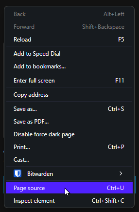
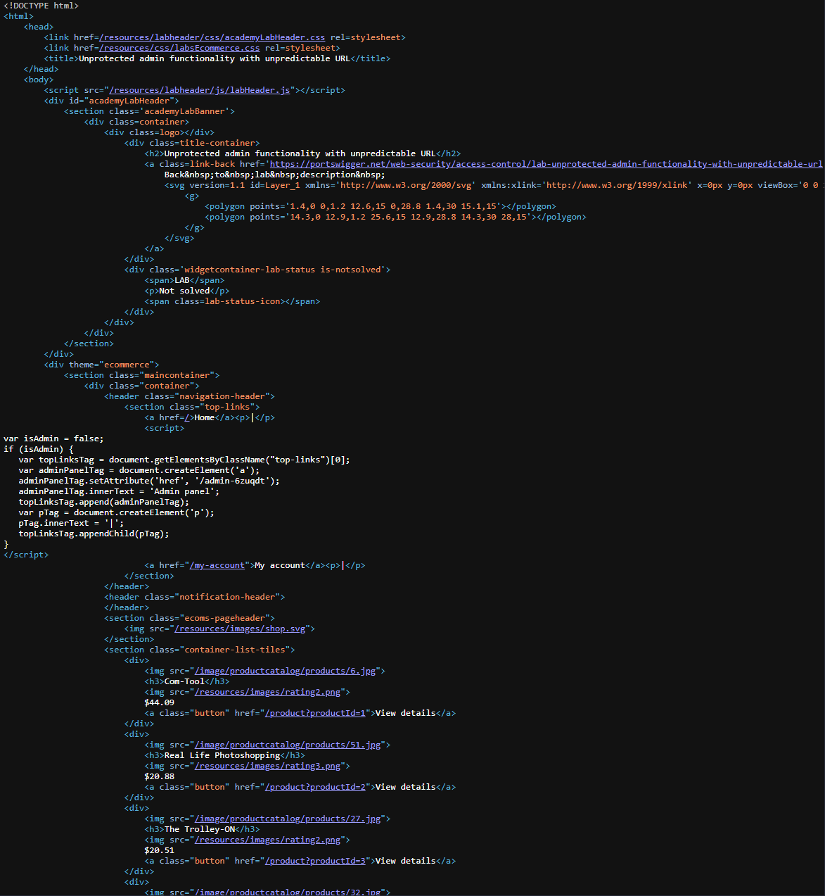
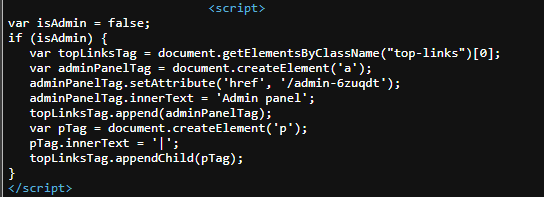

# Unprotected admin functionality with unpredictable URL

```
❓

This lab has an unprotected admin panel. It's located at an unpredictable location, but the location is disclosed somewhere in the application.

Solve the lab by accessing the admin panel, and using it to delete the user `carlos`.
```

This lab hides a bit of JavaScript in the Page-source, right click anywhere on the homepage and click “Page Source” (the title maybe vary based on your browser)  



Immediately after viewing the page source, I notice some JavaScript referencing some Admin stuff.





## Script Breakdown

```html
<script>
var isAdmin = false;
if (isAdmin) {
   var topLinksTag = document.getElementsByClassName("top-links")[0];
   var adminPanelTag = document.createElement('a');
   adminPanelTag.setAttribute('href', '/admin-6zuqdt');
   adminPanelTag.innerText = 'Admin panel';
   topLinksTag.append(adminPanelTag);
   var pTag = document.createElement('p');
   pTag.innerText = '|';
   topLinksTag.appendChild(pTag);
}
</script>

```

### Step-by-Step Breakdown:

1. **Variable Declaration:**
   ```javascript
   var isAdmin = false;

   ```

   - A variable named `isAdmin` is declared and initialized to `false`.
2. **Conditional Check:**
   ```javascript
   if (isAdmin) {

   ```

   - The script checks if the `isAdmin` variable is `true`. Since `isAdmin` is `false`, the code inside the `if` block will not be executed.
3. **DOM Manipulation (Inside the if block):**
   - **Select the Top Links Element:**
     ```javascript
     var topLinksTag = document.getElementsByClassName("top-links")[0];

     ```

     - This line selects the first HTML element with the class name `top-links` and stores it in the variable `topLinksTag`.
   - **Create the Admin Panel Link:**
     ```javascript
     var adminPanelTag = document.createElement('a');
     adminPanelTag.setAttribute('href', '/admin-6zuqdt');
     adminPanelTag.innerText = 'Admin panel';

     ```

     - An `a` (anchor) element is created and stored in the variable `adminPanelTag`.
     - The `href` attribute of the `adminPanelTag` is set to `/admin-6zuqdt`, which is the URL the link will navigate to.
     - The inner text of the `adminPanelTag` is set to `Admin panel`.
   - **Append the Admin Panel Link:**
     ```javascript
     topLinksTag.append(adminPanelTag);

     ```

     - The `adminPanelTag` (admin panel link) is appended as a child to the `topLinksTag` element.
   - **Create and Append the Separator:**
     ```javascript
     var pTag = document.createElement('p');
     pTag.innerText = '|';
     topLinksTag.appendChild(pTag);

     ```

     - A `p` (paragraph) element is created and stored in the variable `pTag`.
     - The inner text of the `pTag` is set to `|` (a vertical bar separator).
     - The `pTag` (separator) is appended as a child to the `topLinksTag` element.

### Summary:

- The script sets a variable `isAdmin` to `false`.
- It contains an `if` statement that checks if `isAdmin` is `true`.
- If `isAdmin` were `true`, it would:
  - Find the first element with the class `top-links`.
  - Create an anchor (`<a>`) element with the text `Admin panel` and link it to `/admin-6zuqdt`.
  - Append this anchor element to the `top-links` element.
  - Create a paragraph (``) element with the text `|` and append it to the `top-links` element.

However, since `isAdmin` is `false`, none of the DOM manipulation code inside the `if` block is executed, so no changes are made to the HTML document.

## Get the Flag

`/admin-6zuqdt` seems to just be the `/admin` directory followed by randomly generated characters. Head over to the admin directory and delete the user `carlos.`
