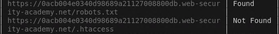
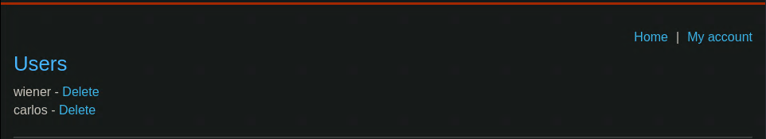

# Unprotected admin functionality

```
❓

This lab has an unprotected admin panel.

Solve the lab by deleting the user `carlos`.
```

This lab was a pretty short one, after doing a directory and common misconfigured files scan  



A `robots.txt` file was found during the scan, heading over to said file I was greeted with this text on the page:

```
User-agent: *
Disallow: /administrator-panel
```

## Solution

The `robots.txt` file contains directives for web crawlers. The line `User-agent: *` means that the directives apply to all web crawlers. The line `Disallow: /administrator-panel` instructs these crawlers not to index or access the `/administrator-panel` path on the website. If we append the `/administrator-panel` directory to the end of the lab URL, we gain access to the admin panel.


