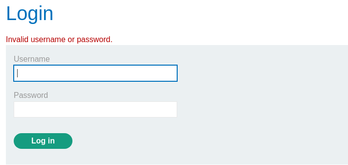
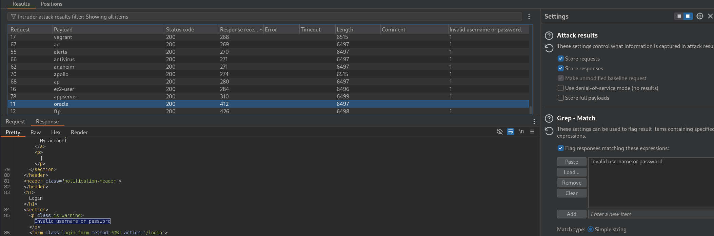
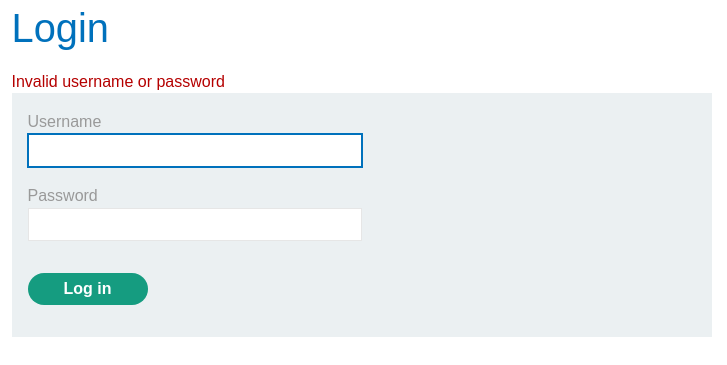

# Username enumeration via subtly different responses

❓ This lab is subtly vulnerable to username enumeration and password brute-force attacks. It has an account with a predictable username and password, which can be found in the following wordlists:

- Candidate [usernames](https://portswigger.net/web-security/authentication/auth-lab-usernames)
- Candidate [passwords](https://portswigger.net/web-security/authentication/auth-lab-passwords)

To solve the lab, enumerate a valid username, brute-force this user's password, then access their account page.

Similar to the previous lab, "Username enumeration via different responses", we are tasked with trying to brute-force the login to an account but responses now vary. For example, instead of “Invalid username” or “Incorrect password”, the `Invalid username or password` makes it harder to tell which user is the correct user now.

The solution to this is to use the `Grep-Match` feature to filter out which response differs from the others, and as we can see the user `oracle` differs from the others because it does not have a period at the end of the invalid username or password message. At this point we can proceed with the password payload and log into the users account.

