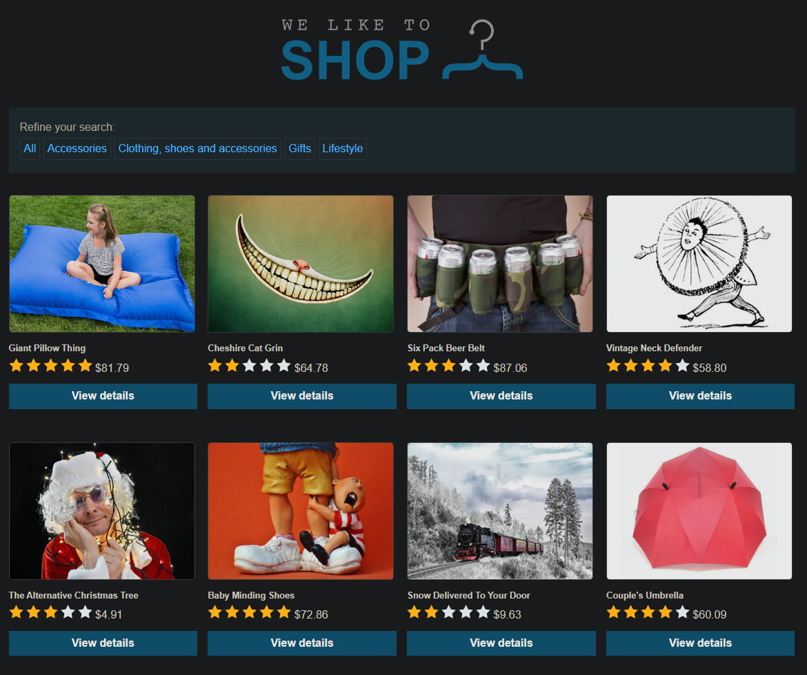
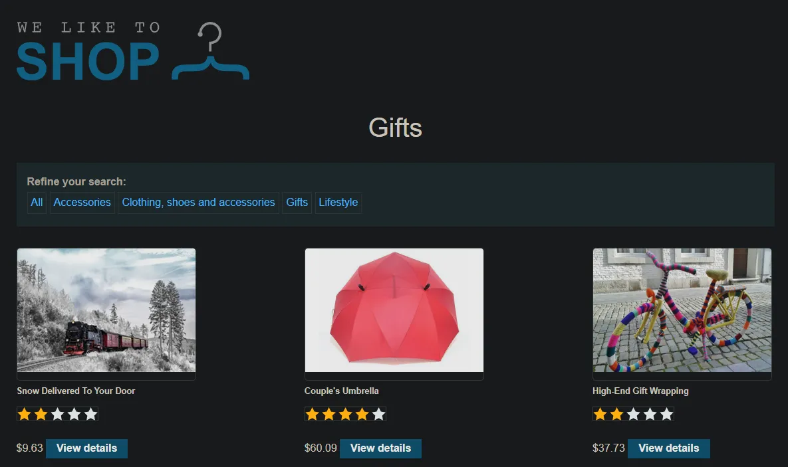

# SQL injection vulnerability in WHERE clause allowing retrieval of hidden data

```
❓

This lab contains a SQL injection vulnerability in the product category filter. When the user selects a category, the application carries out a SQL query like the following: SELECT \* FROM products WHERE category = 'Gifts' AND released = 1

To solve the lab, perform a SQL injection attack that causes the application to display one or more unreleased products.
```



Click on the `Gifts` filter so the page only displays all items with the “Gifts” filter. After doing so take a look at the URL 



```txt
https://0a00003203cb5e1b8256dd14006b00f3.web-security-academy.net/filter?category=Gifts
```

We can inject our payload into the URL by closing out the `Gifts` value in the category parameter using `'` and injecting our SQL query following the quotation and commenting out the rest of the query like so:

```txt
https://0a1700b3032a26bc81aae86d008b0001.web-security-academy.net/filter?category=Gifts'+or+1=1--
```

---

# Why does this work?

### Breakdown of the Workflow

When the user clicks on one of the filters the site, it appends the filter subdirectory to the existing URL query.

- **Client-Side Action**
  - The user clicks on the link `<a href="/filter?category=Gifts">Gifts</a>`.
  - The browser sends this HTTP GET request to the server:
    ```sql
    GET /filter?category=Gifts HTTP/1.1
    Host: example.com
    ```
- **Server-Side Handling**
  - The server receives the request and extracts the query parameter `category=Gifts`.
  - The server's backend code uses this value (`Gifts`) to construct a SQL query to retrieve the relevant products from the database.
  - For example:
    ```sql
    SELECT * FROM products WHERE category = 'Gifts' AND released = 1;
    ```

    - Here:
      - `products` is the name of the database table.
      - `category = 'Gifts'` filters the rows where the category is "Gifts".
      - `released = 1` ensures only released products are shown.
- **Database Query**
  - The SQL query runs on the database, which retrieves all rows from the `products` table that match the condition (`category = 'Gifts'` and `released = 1`).
- **Response to the Client**
  - The server takes the retrieved data and dynamically generates an HTML page containing the filtered products.
  - This HTML is sent back as the response to the client.
  - The browser renders the page, and the user sees the filtered products.

If the server does not properly sanitize the input from the query string (`category`), a malicious user could exploit it by injecting SQL commands. For example:

### URL:

```sql
/filter?category=Gifts'+or+1=1--
```

### Resulting SQL Query:

```sql
SELECT * FROM products WHERE category = 'Gifts' OR 1=1-- AND released = 1;
```

This URL request and SQL query represent a typical **SQL injection attack** aimed at bypassing filters or extracting unintended data from a database.

### URL Breakdown

The URL `/filter?category=Gifts'+or+1=1--` is a **malicious request** where the `category` parameter includes SQL injection payload:

- `Gifts'`: Ends the valid string `category = 'Gifts'` in the query.
- `or 1=1`: Injects an always-true condition into the SQL statement, bypassing filters or restrictions.
- `-`: Marks the rest of the SQL statement as a comment, effectively ignoring everything after this marker (e.g., `AND released = 1`).

---

### How the Server Processes This Request

When the server receives the request, it extracts the value of the `category` parameter (`Gifts' or 1=1--`) and uses it in the SQL query:

### Full SQL Query:

```sql
SELECT * FROM products WHERE category = 'Gifts' OR 1=1-- AND released = 1;
```

---

### How the SQL Query Executes

1. **Original Query Structure:**
   ```sql
   SELECT * FROM products WHERE category = 'Gifts' AND released = 1;
   ```

   - This query is designed to:
     - Select rows from the `products` table.
     - Filter rows where `category = 'Gifts'`.
     - Further filter rows where `released = 1`.
2. **Injected Query with Malicious Payload:**
   ```sql
   SELECT * FROM products WHERE category = 'Gifts' OR 1=1-- AND released = 1;
   ```

   - The attacker injects `OR 1=1--`, altering the logic:
     - `category = 'Gifts'`: Matches rows where the category is `Gifts`.
     - `OR 1=1`: Matches **all rows** because `1=1` is always true.
     - `-`: Comments out the remaining part of the query (`AND released = 1`), bypassing additional restrictions.
3. **Effect of Injection:**
   - The query effectively becomes:
     ```sql
     SELECT * FROM products;
     ```
   - This retrieves **all rows** from the `products` table, bypassing both the `category` filter and the `released` filter.
